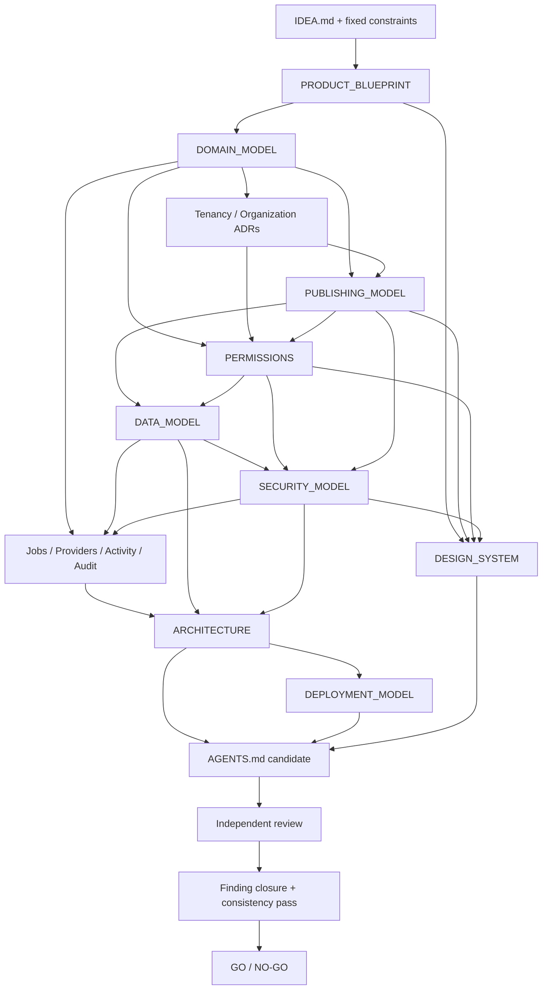

# TravelOS Phase 0 — Architecture Planning Execution Plan

**Status:** Proposed plan; not executed  
**Mode:** Phase 0 planning and documentation only  
**Author:** Alex  
**Primary source:** `IDEA.md`, read completely before preparing this plan  
**Development target:** Proxmox `pxmx2`, CT `200`, `travelos-dev`, DEVELOPMENT

## 1. Objective

Phase 0 converts the product idea and fixed constraints into an agreed, reviewable technical foundation. Its outputs are architecture documents, accepted Architecture Decision Records (ADRs), a risk/decision trail, and a root `AGENTS.md` engineering constitution.

Phase 0 does **not** produce working software. It must make Phase 1 safe to begin without pretending that early domain, security, persistence, or deployment decisions can be deferred to implementation.

The first authored product artifact must be `docs/PRODUCT_BLUEPRINT.md`. Stack selection and schema design must not precede agreement on actors, lifecycle, vocabulary, scope, invariants, scale assumptions, and non-functional requirements.

## 2. Non-negotiable guardrails

The following are constraints, not casual discussion points:

- One customer agency normally receives one isolated deployment.
- The default deployment unit is one Proxmox CT with one independent PostgreSQL database.
- Every installation runs the same versioned TravelOS codebase; customer forks are forbidden.
- The initial application is a modular monolith; bounded contexts are not microservices.
- Portal trip views never read or serialize mutable agency workspace state.
- Preview has no publication side effects.
- Publish creates a new immutable customer-facing snapshot; old versions remain auditable.
- Itinerary items are independent typed objects.
- Reservations and itinerary items are different concepts.
- Customer visibility resolves Platform Default → Agency Default → Item Override, except permanently `INTERNAL_ONLY` fields.
- Agency staff identities and portal identities are different security principals.
- Trip membership does not imply access to another traveller's documents.
- Money never uses binary floating point.
- Activity Timeline, Audit Log, domain events, and outbox records are separate concerns.
- External systems are isolated behind provider ports/adapters.
- Automation precedes AI; AI is outside the core architecture.
- No future fleet requirement may be met with hand-edited customer code or schema variants.

## 3. Allowed and forbidden Phase 0 work

### Allowed

- Create and edit Markdown architecture documents, Mermaid diagrams, ADRs, review reports, and root `AGENTS.md`.
- Conduct product/domain workshops and document assumptions, decisions, risks, and unresolved questions.
- Perform read-only inspection of CT 200 only where a deployment decision needs an environmental fact.
- Review framework/ORM/tool documentation without installing or scaffolding anything.

### Explicitly forbidden

- Installing software or changing CT 200.
- Initialising Next.js, NestJS, Prisma, PostgreSQL, queues, object storage, or any application package.
- Creating databases, schemas, migrations, seed data, secrets, users, services, containers, DNS, TLS, firewall rules, CI workflows, or deployment automation.
- Writing production application code, executable spikes, or placeholder implementations.
- Building a Control Plane, microservice, provider implementation, AI feature, or customer-specific branch/fork.
- Treating a diagram, Prisma sketch, or ADR as proof that runtime behaviour works.

If a decision cannot responsibly be made without an executable spike, Phase 0 records that as a **NO-GO blocker** and seeks separate approval; it does not quietly start implementation.

## 4. Decision process and document status

Every document and ADR uses one of: `Draft`, `In Review`, `Accepted`, or `Superseded`.

Each significant decision records:

1. problem and decision owner;
2. fixed constraints;
3. options considered;
4. chosen option and rationale;
5. rejected alternatives and trade-offs;
6. security, data, operability, and migration consequences;
7. validation evidence or review scenarios;
8. follow-up decisions and explicit deferrals.

Architecture choices with meaningful alternatives must not be hidden only in narrative documents; they require an ADR. All canonical documents include links to their governing ADRs. A traceability appendix in `docs/ARCHITECTURE.md` maps every Phase 0 requirement to a document section, ADR, risk, and future test class.

## 5. Ordered execution plan

### Step 0 — Establish the read-only baseline and decision register

**Purpose:** distinguish known facts, fixed constraints, assumptions, and open decisions before design begins.

Actions during Phase 0 execution:

- Record repository baseline and authoritative source documents.
- If necessary, perform a read-only CT 200 inventory limited to OS/architecture, init system, resources, storage layout, network exposure, container capabilities, and backup integration. Never output credentials or change state.
- Create a decision/risk register inside `docs/ARCHITECTURE.md` while it is being drafted.
- Identify required domain-expert inputs: operating markets, expected agency/user/trip/document volumes, currency/tax expectations, retention obligations, portal enrolment/recovery, RPO/RTO, custom-domain expectations, and initial provider categories.

**Gate G0:** facts, assumptions, and constraints are separated; contradictions are either resolved or marked as blockers.

---

### Step 1 — Create `docs/PRODUCT_BLUEPRINT.md`

This is the first canonical document. It defines:

- product vision, North Star, actors, jobs, and anti-goals;
- lifecycle from Lead through Post-trip, including where records transform versus remain linked;
- initial Phase 1 vertical-slice boundary and explicit non-goals;
- agency staff, portal user, customer, person, traveller, supplier, and organization terminology;
- functional capability map without pretending all capabilities are Phase 1;
- non-functional requirements: security, privacy, auditability, accessibility, latency classes, availability, capacity envelope, RPO/RTO, retention, and data residency assumptions;
- product-level invariants, especially publication and document privacy;
- assumptions requiring Rui/domain-expert acceptance.

**Dependency:** only `IDEA.md` and fixed constraints.  
**Gate G1:** vocabulary, initial scope, workload envelope, and non-functional targets are accepted. No database or framework decision proceeds on an unresolved product meaning.

---

### Step 2 — Create `docs/DOMAIN_MODEL.md`

Use domain discovery/event-storming around the lifecycle, then define:

- ubiquitous-language glossary;
- core, supporting, and generic subdomains;
- bounded-context map, context owners, inputs/outputs, and translation boundaries;
- aggregate roots, entities, value objects, invariants, commands, domain events, and state transitions;
- which consistency rules are transactional and which may be eventual;
- explicit distinction among Customer, Person, Traveller, Portal Identity, and Staff Identity;
- explicit lifecycle links among Travel Request, Opportunity, Quote Version, Sale, Trip, Reservation, and Itinerary Item;
- activity-producing events versus security-audit events;
- module dependency graph with no cyclic context dependencies.

Initial context hypotheses to validate—not silently assume—are:

1. Agency & Organization
2. Staff Identity & Access
3. CRM / People & Travellers
4. Sales / Requests / Opportunities / Quotes
5. Trip Operations / Itinerary / Reservations
6. Publishing & Customer Presentation
7. Finance
8. Documents
9. Tasks & Customer Service
10. Communications
11. Activity & Audit
12. Integrations & Automation

A bounded context is a model boundary inside the monolith, not a promise of a future service.

**Dependency:** accepted Product Blueprint.  
**Gate G2:** every core concept has one canonical owner; aggregates are small; cross-context references are by stable identity/contract rather than shared mutable objects; the model passes a domain walkthrough.

---

### Step 3 — Decide deployment tenancy and organization semantics

Before permissions or table design, settle the distinction between deployment, agency, organization unit, team, and user membership.

The preferred hypothesis to test is:

- `Deployment/Instance` is operational metadata, not a normal business aggregate.
- One deployment contains one root Agency tenant in v1.
- Branches, brands, or business units are `OrganizationUnit` records beneath that Agency; teams are a separate collaboration concept.
- Every tenant-owned record carries the root Agency scope even though the database is dedicated; an optional organization-unit owner provides internal scoping.
- Cross-agency references are structurally impossible through composite constraints and application policy.
- V1 does not pretend to support multiple unrelated agencies in one deployment, but its root scope does not block a distant shared-cloud model.

Create and accept:

- `ADR-002 Dedicated Single-Tenant Deployment`
- `ADR-003 Independent Database Per Instance`

**Dependencies:** Product Blueprint and Domain Model.  
**Gate G3a:** one canonical tenancy vocabulary and scoping rule exists; branches are not confused with tenants; no per-customer schema/custom code path exists.

---

### Step 4 — Define itinerary, reservation, and publishing semantics

Create `docs/PUBLISHING_MODEL.md` and the relevant sections of `docs/DOMAIN_MODEL.md`.

#### Structured itinerary decisions

- Define a common itinerary-item envelope plus family-specific structured models.
- Define family invariants, segment/leg children, ordering, traveller applicability, status, supplier links, and temporal semantics.
- Store IANA time-zone identity and local scheduled values where travel meaning requires it; do not rely only on UTC offsets.
- Decide how `Other` remains structured without becoming an unvalidated dumping ground.
- Model Reservation separately from Itinerary Item and explicitly decide cardinality. The default hypothesis is an association entity supporting one reservation covering several items and an item linking to more than one reservation where the domain genuinely needs it.
- Reservation status, commercial/booking references, and supplier operations must not be copied into itinerary presentation accidentally.

#### Publishing decisions

- Define a customer-facing allowlist schema, never “serialize the internal object and remove fields.”
- Permanently `INTERNAL_ONLY` fields must be unrepresentable in the portal snapshot contract.
- Resolve field visibility at publication time: platform rule, agency override where permitted, item override where permitted.
- Preview uses the same projection/validation code as publish but creates no publication, does not advance a version, and does not move the portal pointer.
- Publish validates an expected draft/source revision to avoid preview/publish race conditions.
- A successful publish atomically creates a versioned immutable snapshot and updates the trip’s current-publication pointer.
- Snapshot metadata includes publication ID/version, source revision, schema version, content hash, actor, timestamp, and effective visibility decisions.
- Portal trip reads use only the publication read model plus explicit portal/document grants.
- Define correction, withdrawal/revocation, retention, schema evolution, and historical-version access without mutating old snapshots.
- Define how GDPR/privacy deletion obligations interact with immutable history; “immutable” cannot mean “retain forbidden personal data forever.”

Create and accept:

- `ADR-004 Immutable Publishing Snapshots`
- `ADR-005 Structured Itinerary Model`

**Dependencies:** Domain Model and organization semantics.  
**Gate G3b:** sequence diagrams prove that editing, previewing, publishing v1, editing again, and publishing v2 preserve the required customer behaviour; a portal path to mutable workspace tables is a blocker.

---

### Step 5 — Create `docs/PERMISSIONS.md`

Define identity and authorization independently of UI navigation.

- Staff Identity and Portal Identity are separate principal types, stores/realms, sessions, cookie namespaces, audiences, invitation/recovery flows, and authorization policies. The same human/email may hold both without identity merging.
- Customer and Traveller are business records, not login accounts.
- Portal trip access is an explicit, revocable grant per principal and trip.
- Document access is a separate explicit grant; same-trip or same-family membership never grants it implicitly.
- Use default-deny RBAC with a code-owned permission registry, configurable role definitions/templates, multiple role assignments, and explicit resource/organization scopes.
- Business logic checks permission identifiers, never role names.
- Define sensitive permissions for costs, margins, payments, publishing, private documents, user/role administration, exports, and audit access.
- Define policy evaluation order, ownership, denial behaviour, revocation, emergency access, and test matrix.
- Avoid a general-purpose policy engine until actual requirements exceed RBAC plus scoped grants.

Create and accept:

- `ADR-007 Separate Staff and Portal Identity Realms`
- `ADR-008 RBAC with Explicit Resource Scopes`

**Dependencies:** Domain Model, organization model, and Publishing Model.  
**Gate G4a:** every sensitive operation has principal, scope, permission, and denial rules; all privilege escalation and IDOR scenarios have planned tests.

---

### Step 6 — Create `docs/DATA_MODEL.md`

Produce a logical model and ownership map, not a database or Prisma schema.

Mandatory decisions:

- relational tables and constraints are the default for core/queryable data;
- JSONB is limited to bounded, versioned extension/provider payloads and never replaces typed itinerary, money, permissions, or publication invariants;
- itinerary uses a common item record with typed family extension/child records rather than one giant nullable table or opaque JSON blob;
- Reservation–Itinerary Item links use an explicit association with trip/agency integrity constraints;
- all tenant-owned uniqueness and foreign keys include root Agency scope where needed to prevent cross-scope linking;
- stable opaque IDs, optimistic concurrency/version columns, timestamps, archive/deletion semantics, and naming conventions are consistent;
- blanket soft deletion is forbidden; retention and lifecycle are domain-specific;
- published snapshots and audit records are append-only by policy and, where practical, database privilege/constraint;
- Activity Timeline, Audit Log, outbox, and job records have separate schemas, purposes, retention, and access rules;
- indexes are derived from named access patterns, not added speculatively.

#### Financial principles

- A domain `Money` value object contains an exact decimal amount and ISO currency code; JavaScript `number`, SQL float, and implicit coercion are forbidden.
- PostgreSQL `numeric` precision/scale and the TypeScript decimal library are selected explicitly.
- Rounding mode and rounding points are explicit and tested.
- Original currency amounts are retained; conversions store converted amount, rate, source, and effective time rather than overwriting originals.
- Costs, sale price, fees, taxes, discounts, commissions, payments, refunds, and derived margin remain distinct concepts.
- Quote/sale financial versions are historical facts; recalculation must not rewrite an accepted historical version.
- TravelOS does not accidentally claim to be a full accounting ledger; accounting-provider boundaries are explicit.

#### Migration policy

- One ordered migration chain applies to every instance; no customer-specific migrations.
- Production changes follow expand → migrate/backfill → contract where compatibility is required.
- Migrations are forward-only operationally; rollback normally means application rollback plus a verified database restore/forward fix, not an untested down migration.
- Every migration is tested against an empty database and the supported previous schema/version with realistic data volume.
- Destructive/locking changes require preflight, backup verification, maintenance/compatibility plan, and fleet rollout strategy.
- Application version, schema version, and minimum/maximum compatible versions are observable.
- Prisma-generated SQL, if Prisma is retained, is reviewed and may use hand-authored SQL for constraints/indexes the ORM cannot express.

Create and accept:

- `ADR-010 Exact Money and Currency Representation`
- `ADR-012 Persistence Boundary and Fleet-Safe Migrations`

**Dependencies:** Domain, Publishing, Permissions, and tenancy decisions.  
**Gate G4b:** ERD and invariant table cover critical links; no float, opaque core JSON, cross-agency FK gap, mutable snapshot, or per-customer migration path remains.

---

### Step 7 — Create `docs/SECURITY_MODEL.md`

Perform a threat model covering staff UI, portal, API, documents, integrations, jobs, database, backups, and fleet operations.

Define:

- authentication mechanisms and trusted library/provider selection; custom password/session cryptography is forbidden;
- staff MFA policy, invitations, recovery, session revocation, lockout/rate limits, CSRF, CORS/origin, secure cookies, and custom-domain implications;
- separate staff/portal endpoints and authorization contexts;
- authorization enforcement in application use cases and scoped repositories, not only UI;
- data classification, PII minimization, log redaction, exports, retention/deletion, and backup handling;
- secrets injected from secure storage and referenced by identifier; never stored in customer configuration, logs, snapshots, or source;
- secure headers, dependency/supply-chain scanning, webhook signature verification, replay protection, and abuse controls;
- audit access and retention.

#### Document model

- File bytes live behind a `StorageProvider`; database rows hold metadata, ownership, checksum, media type, size, version, classification, scan/quarantine state, and storage key.
- Files are never served from a public directory or predictable filesystem URL.
- Downloads require authorization on every request or a narrowly scoped, short-lived signed capability.
- Portal grants are document/version-specific or explicitly scoped; trip membership alone is insufficient.
- Uploads validate size/type, sanitize names, verify checksums, and support malware scanning/quarantine before release.
- Upload, download, grant, revoke, delete, quarantine, and export actions create security audit events without logging document contents.
- Encryption, backups, restore, retention, legal/privacy deletion, and orphan cleanup are specified.

Create and accept:

- `ADR-011 Document Storage and Explicit Access Grants`

**Dependencies:** Permissions, Publishing, Data Model, and deployment assumptions.  
**Gate G4c:** threat model has mitigations and planned abuse tests; portal/staff session confusion, document IDOR, internal-field leakage, and secret leakage are blockers.

---

### Step 8 — Define jobs, outbox, activity, audit, and integrations

Capture the final decisions in `docs/ARCHITECTURE.md` and `docs/DATA_MODEL.md`.

#### Jobs and outbox

- Domain events are immutable business facts; integration events are versioned external contracts.
- The state change and outbox row commit in the same PostgreSQL transaction.
- Delivery is at-least-once; every handler/provider command needs an idempotency strategy.
- The worker is a separate process/composition root from the same codebase and deployment, not a microservice.
- Prefer a PostgreSQL-backed job mechanism initially to avoid a Redis/message-broker dependency per CT; choose the concrete library only after an ADR comparison.
- Define retries with capped backoff/jitter, timeout, lease/heartbeat, ordering requirements, dead-letter/quarantine, replay, cancellation, and operator visibility.
- External calls do not occur inside core database transactions.

#### Activity versus audit

- Activity Timeline is a human-readable product projection of meaningful domain activity; it may include curated/manual entries and obey product visibility.
- Audit Log is append-only security/accountability evidence with actor, principal type, action, target, scope, outcome, correlation, and safe change metadata.
- Audit is not event sourcing, an application log, or the outbox. It never stores secrets or unrestricted before/after payloads.

#### Providers

- Ports are capability-based (`PaymentProvider`, `StorageProvider`, etc.), not vendor-shaped.
- Vendor adapters translate through anti-corruption layers; provider IDs and payloads do not become domain identities/models.
- Manual/no-provider operation is a supported first-class path.
- Configuration and credential references are per instance/agency, schema-validated, and external to core domain logic.
- Inbound webhooks use a verified, idempotent inbox with signature/timestamp validation and replay handling.
- Define canonical error categories, timeouts, circuit breaking/rate limits, telemetry, sandbox/fake conformance tests, and provider contract tests.

Create and accept:

- `ADR-006 Provider-Based Integration Architecture`
- `ADR-009 Transactional Outbox and PostgreSQL-Backed Jobs`

**Dependencies:** Domain, Data, Security, and Deployment constraints.  
**Gate G5a:** duplicate, delayed, reordered, failed, and replayed work has defined behaviour; domain code has no vendor imports.

---

### Step 9 — Critically decide the application stack and repository shape

Create the stack decision matrix and monorepo section in `docs/ARCHITECTURE.md`.

#### Provisional stack assessment

| Candidate | Provisional disposition | Required rationale/trade-off |
|---|---|---|
| TypeScript | Keep | One language and strong tooling; runtime trust boundaries still require validation. |
| Two separately deployed web apps | Keep | Admin and Portal have different threat models and release surfaces. Shared design tokens are allowed; shared privileged data access is not. |
| Next.js for both apps | Re-evaluate before accepting | Authenticated products have little SEO need. Two Next servers add per-instance memory, cache/server-action complexity, and fleet surface. Prefer static React/Vite unless SSR, server rendering, link metadata, or another measured requirement justifies Next. If Next is kept, it cannot become a second backend or access the database. |
| NestJS API | Keep provisionally | Useful module/composition/DI/OpenAPI structure; domain/application code must remain framework-independent to avoid Nest-shaped business logic. |
| PostgreSQL | Keep | Strong transactions, constraints, relational querying, exact numeric types, and outbox/job suitability. |
| Prisma | Conditional | Keep only if the ADR demonstrates exact decimals, transaction/concurrency needs, custom constraints/indexes, migration review, and strict mapper isolation. Otherwise select a SQL-first alternative such as Kysely/Drizzle plus a migration tool. Prisma entities never cross into domain or API contracts. |
| pnpm workspaces | Keep | Sufficient workspace/package management with low overhead. |
| Turborepo | Defer unless task-graph/caching value is demonstrated | `pnpm -r` may be enough initially; adding Turbo later is cheap. Avoid configuration merely for popularity. |
| Tailwind | Keep | Efficient token-based implementation if constrained by the design system. |
| shadcn/ui | Keep conditionally | Treat it as owned source primitives, not a finished design system; accessibility and product consistency remain TravelOS responsibilities. |
| Zod | Keep | Validate HTTP, configuration, provider, and snapshot boundaries; do not duplicate schemas without an ownership/code-generation policy. |
| Playwright | Keep | Essential for publication, identity, document-access, and responsive portal acceptance. Add a unit/integration runner and real-PostgreSQL tests. |
| Separate worker | Keep as optional process | Same modular-monolith code and database; start only when asynchronous work exists. No premature service split. |

The Phase 0 ADR must settle, not merely discuss, the web framework, ORM/persistence approach, package graph, contract ownership, and build orchestrator before GO.

#### Preferred repository hypothesis

```text
apps/
  admin-web/          # staff UI only
  portal-web/         # customer UI only
  api/                # HTTP composition root
  worker/             # background composition root
packages/
  backend-core/       # bounded modules: domain, application, adapters
  contracts/          # versioned runtime/API contracts; never ORM entities
  design-system/      # tokens and accessible primitives
  config/             # typed config schema
  observability/      # logging/metrics/tracing facade
  test-support/       # factories/harnesses, no production dependencies inward
docs/
  adr/
```

Inside `backend-core`, modules are capability-oriented and each separates domain/application from infrastructure and delivery adapters. Enforce a cycle-free dependency graph with tooling/tests. Avoid both one global “shared” dumping ground and one package per tiny class.

Create and accept:

- `ADR-001 Modular Monolith`
- `ADR-013 Monorepo, Web Runtime, and Build Orchestration`

**Dependencies:** Domain boundaries and all critical data/security paths.  
**Gate G5b:** every dependency direction is documented; no frontend, ORM, Nest, or provider type leaks into the domain; every retained technology solves a named requirement.

---

### Step 10 — Create `docs/DEPLOYMENT_MODEL.md`

Define a reproducible dedicated-instance topology without building it:

- reverse proxy/TLS boundary;
- Admin web, Portal web, API, optional Worker, PostgreSQL, document storage, and backup responsibilities;
- network flows and ports by role, with database/storage non-public;
- one immutable, versioned build artifact promoted through environments rather than rebuilt per customer;
- external typed configuration for instance ID, agency bootstrap, branding, domains, feature entitlements, provider selection, and secret references;
- no customer patches, local source edits, or divergent schemas;
- liveness, readiness, build version, schema version, config version, and queue/outbox health;
- backup scope, encryption, off-instance copies, restore rehearsal, and agreed RPO/RTO;
- upgrade preflight, maintenance/compatibility strategy, staged fleet rollout, failure stop conditions, rollback/restore, and version inventory;
- a future provisioning/control-plane contract—instance manifest, health/version surface, reproducible artifact and config—without implementing the Control Plane.

#### Environment strategy

- CT 200 remains DEVELOPMENT and contains no production customer data.
- Staging is a separate instance and database with synthetic/sanitized data; it is not a schema or flag inside development.
- Production is one isolated deployment/database per agency by default.
- The same artifact digest moves dev → staging → production; environment changes only external configuration/secrets.
- Production data is never copied to development without an approved sanitization process.
- Schema migrations run per instance with fleet status, preflight, backup, health checks, and stop-on-failure semantics.

**Dependencies:** Architecture, Data, Security, jobs, and stack decisions.  
**Gate G5c:** an operator can conceptually provision, upgrade, back up, restore, observe, and roll back an instance from declared inputs; nothing requires a customer fork or manual code edit.

---

### Step 11 — Create `docs/DESIGN_SYSTEM.md`

Define design principles, not UI implementation:

- separate Admin and Portal information architectures;
- mobile-first Portal and responsive, keyboard-efficient Admin;
- token hierarchy, typography, spacing, colour, density, motion, and white-label boundaries;
- WCAG target, focus, keyboard, contrast, reduced motion, and screen-reader expectations;
- standard loading/empty/error/offline/stale/permission-denied states;
- forms, tables, timeline, itinerary, financial redaction, document states, and publish/preview affordances;
- prominent environment and preview indicators so preview cannot be mistaken for publication;
- secure rendering rules: UIs consume explicit view models and never infer authorization from hidden controls.

**Dependencies:** Product Blueprint, Publishing, Permissions, and Security.  
**Gate G5d:** Admin and Portal can share visual primitives without sharing privileged data assumptions; accessibility and mobile acceptance criteria are testable.

---

### Step 12 — Finalise `docs/ARCHITECTURE.md` and root `AGENTS.md`

`docs/ARCHITECTURE.md` integrates:

- system-context, container, and module diagrams;
- module ownership/dependency rules and transaction boundaries;
- API and contract strategy;
- all stack decisions and consequences;
- publishing, authorization, documents, jobs/outbox, provider, activity, and audit flows;
- testing, CI, migrations, and observability strategies;
- risk/assumption register and complete requirements traceability matrix.

#### Testing strategy

Plan these layers:

1. pure domain invariant/state-machine unit tests;
2. permission and field-visibility policy matrix/property tests;
3. module integration tests against real PostgreSQL;
4. API/contract and provider conformance tests;
5. publication snapshot golden/schema tests proving internal-only fields are impossible;
6. identity, IDOR, CSRF, session-confusion, document-grant, and organization-scope security tests;
7. outbox/job idempotency, retry, crash-recovery, and replay tests;
8. migration tests from empty and supported prior versions;
9. Playwright end-to-end tests for the canonical v1/v2 publication flow and responsive Portal;
10. deployment, health, backup/restore, and rollback smoke tests before production readiness.

#### CI strategy

Define—but do not create—the pipeline:

- formatting/lint and architecture-boundary checks;
- typecheck and unit tests;
- migration validation with disposable PostgreSQL;
- integration/contract/security tests;
- builds for every deployable app/process;
- Playwright critical paths and accessibility checks;
- secret/dependency/license/container scanning as applicable;
- produce one immutable versioned artifact, provenance/SBOM metadata, and publish only after all gates;
- promote the same digest; never rebuild per customer;
- protect main, require independent review, and prevent merge on failing required checks.

#### Logging and observability strategy

- structured JSON logs with timestamp, level, process, environment, instance ID, app/schema version, module, request/trace/correlation ID, safe actor/principal reference, action, outcome, and duration;
- explicit redaction: no credentials, tokens, document content, payment secrets, raw provider payloads, or unnecessary PII;
- vendor-neutral metrics/traces, with OpenTelemetry considered only if it reduces lock-in and operational burden;
- liveness/readiness and metrics for HTTP latency/errors, auth failures, publication success/failure, queue depth, outbox age, retries/dead letters, database pool, storage, backup age, and schema mismatch;
- per-instance stable labels suitable for future fleet aggregation;
- SLOs and alert ownership derived from Product Blueprint, not arbitrary dashboards;
- application logs are not Activity Timeline or Audit Log.

#### Root `AGENTS.md`

Create only after the architecture candidate is coherent. It becomes a concise constitution, not a duplicate textbook. It must contain:

- authoritative docs and ADR hierarchy;
- non-negotiable product/security rules;
- module/dependency and API-contract rules;
- publishing, identity, document, money, audit, outbox, provider, and no-fork constraints;
- test/migration/review/definition-of-done gates;
- rules for updating ADRs before changing accepted architecture;
- prohibition on invented commands/results and on unverified deployment claims;
- only commands that actually exist and have been verified; no scaffolding-era placeholders.

**Gate G6 candidate freeze:** all required docs/ADRs and `AGENTS.md` are internally consistent and marked `In Review`; the traceability matrix has no missing Phase 0 requirement.

---

### Step 13 — Independent architecture review

Use another strong agent that did not author the documents and is not asked to implement. Give it a frozen review bundle containing `IDEA.md`, every Phase 0 document/ADR, `AGENTS.md`, constraints, and the traceability matrix.

The reviewer must actively challenge:

- wrong or leaky bounded contexts and oversized aggregates;
- premature abstractions/infrastructure and accidental distributed-monolith design;
- per-CT resource/operational burden and thousand-instance fleet traps;
- cross-agency, cross-organization, staff/portal, traveller, and document data leakage;
- preview side effects, stale-publication races, internal-field serialization, snapshot evolution, correction/withdrawal, and privacy deletion;
- itinerary subtype/query design and Reservation–Itinerary cardinality;
- exact-money precision, rounding, currencies, historical recalculation, and payment/accounting confusion;
- authentication, authorization, IDOR, session confusion, privilege escalation, secrets, provider/webhook replay, and audit integrity;
- migration locking, partial fleet rollout, app/schema compatibility, backup/restore, and difficult rollback paths;
- any configuration path that becomes a customer fork.

Required adversarial walkthroughs include concurrent preview/publish, staff editing after preview, portal URL enumeration, same-trip document access, role revocation during a session, duplicate/out-of-order jobs, provider webhook replay, failed migration halfway through a large fleet, restore to an older schema/app version, and snapshot rendering after schema evolution.

Each finding must include:

- stable ID;
- severity: `BLOCKER`, `HIGH`, `MEDIUM`, or `LOW`;
- affected document/ADR;
- evidence or concrete failure scenario;
- consequence;
- recommended change;
- author disposition and rationale;
- reviewer closure status.

Store the report as `docs/reviews/PHASE_0_ARCHITECTURE_REVIEW.md`.

**Gate G7 review closure:**

- zero open BLOCKER findings;
- every valid HIGH finding is resolved in the documents/ADRs and closure-verified by the reviewer;
- rejected HIGH findings have explicit evidence/rationale and reviewer acknowledgement, not unilateral dismissal;
- MEDIUM findings have an owner, target phase, and accepted risk statement;
- LOW findings are recorded without blocking unless collectively systemic.

If review changes an architectural decision, update the ADR first, then dependent documents and `AGENTS.md`, and run a focused reviewer closure pass.

---

### Step 14 — Consistency and acceptance pass

Run a documentation-only final validation:

- all links and Mermaid diagrams resolve/render;
- terms match the ubiquitous-language glossary;
- diagrams, logical model, permissions, and prose agree;
- every Phase 0 requirement maps to at least one accepted section and planned test;
- every major choice has an accepted ADR;
- no `TBD` remains on a security-, data-integrity-, publication-, migration-, or deployment-critical path;
- no document implies customer forks, portal access to mutable workspace data, implicit document access, floating-point money, or AI dependence;
- all reviewer closure edits are reflected in `AGENTS.md`.

Mark the documents and ADRs `Accepted` only after this pass and Rui’s product/constraint acceptance.

## 6. Document dependency graph



Documents may be drafted iteratively, but acceptance must respect this dependency order.

## 7. Required artifact set

### Canonical documents

- `docs/PRODUCT_BLUEPRINT.md`
- `docs/DOMAIN_MODEL.md`
- `docs/ARCHITECTURE.md`
- `docs/DEPLOYMENT_MODEL.md`
- `docs/DATA_MODEL.md`
- `docs/PUBLISHING_MODEL.md`
- `docs/PERMISSIONS.md`
- `docs/DESIGN_SYSTEM.md`
- `docs/SECURITY_MODEL.md`
- `docs/reviews/PHASE_0_ARCHITECTURE_REVIEW.md`
- root `AGENTS.md`

### Minimum accepted ADRs

- `docs/adr/ADR-001-modular-monolith.md`
- `docs/adr/ADR-002-dedicated-single-tenant-deployment.md`
- `docs/adr/ADR-003-independent-database-per-instance.md`
- `docs/adr/ADR-004-immutable-publishing-snapshots.md`
- `docs/adr/ADR-005-structured-itinerary-model.md`
- `docs/adr/ADR-006-provider-based-integration-architecture.md`

### Additional ADRs required before implementation

- ADR-007 Separate Staff and Portal Identity Realms
- ADR-008 RBAC with Explicit Resource Scopes
- ADR-009 Transactional Outbox and PostgreSQL-Backed Jobs
- ADR-010 Exact Money and Currency Representation
- ADR-011 Document Storage and Explicit Access Grants
- ADR-012 Persistence Boundary and Fleet-Safe Migrations
- ADR-013 Monorepo, Web Runtime, and Build Orchestration

A short ADR index records status and supersession links.

## 8. Coverage of the 25 required architecture topics

| # | Topic | Canonical owner(s) |
|---:|---|---|
| 1 | Product architecture | Product Blueprint, Architecture |
| 2 | Domain boundaries | Domain Model |
| 3 | Initial domain model | Domain Model |
| 4 | Data-model strategy | Data Model |
| 5 | Dedicated single-tenant deployment | Deployment Model, ADR-002/003 |
| 6 | Organization model in each deployment | Domain Model, Permissions, Data Model |
| 7 | Authentication model | Security Model, ADR-007 |
| 8 | Roles and permissions | Permissions, ADR-008 |
| 9 | Staff versus Portal identity | Permissions, Security Model, ADR-007 |
| 10 | Publishing | Publishing Model, ADR-004 |
| 11 | Structured itinerary | Domain/Data Model, ADR-005 |
| 12 | Reservation versus itinerary | Domain/Data Model |
| 13 | Financial principles | Domain/Data Model, ADR-010 |
| 14 | Documents/security | Security/Data Model, ADR-011 |
| 15 | Activity Timeline | Domain Model, Architecture, Data Model |
| 16 | Audit Log | Security Model, Architecture, Data Model |
| 17 | Jobs/outbox | Architecture, Data Model, ADR-009 |
| 18 | Provider architecture | Architecture, ADR-006 |
| 19 | Repository/monorepo | Architecture, ADR-013, AGENTS.md |
| 20 | Dev/staging/production | Deployment Model |
| 21 | Testing | Architecture, AGENTS.md |
| 22 | CI | Architecture, Deployment Model, AGENTS.md |
| 23 | Migration policy | Data/Deployment Model, ADR-012 |
| 24 | Logging/observability | Architecture, Security, Deployment Model |
| 25 | ADRs | `docs/adr/` index and accepted records |

## 9. What counts as Phase 0 complete

Phase 0 is complete only when:

1. every required document exists, is internally consistent, and is marked `Accepted`;
2. all minimum and additional critical ADRs are accepted;
3. product vocabulary, Phase 1 boundary, capacity envelope, SLO/RPO/RTO, privacy/retention assumptions, and non-goals are explicit;
4. bounded contexts, aggregates, invariants, state transitions, and context contracts are defined;
5. the portal can only obtain explicitly published presentation data, and document access is separately granted;
6. identity, organization, authorization, money, itinerary/reservation, publishing, audit/activity, outbox/jobs, provider, and migration semantics have no critical `TBD`;
7. deployment is reproducible in design and fleet-compatible without implementing a Control Plane;
8. testing, CI, observability, backup/restore, upgrade, and rollback gates are specified;
9. the independent review has zero open BLOCKER and zero unresolved valid HIGH findings;
10. root `AGENTS.md` accurately distils the accepted foundation;
11. no application, database, service, or infrastructure has been initialised as a shortcut.

## 10. Proposed GO / NO-GO gate for Phase 1

### GO

Enter Phase 1 only with a recorded joint decision by Rui (product/constraints), Alex (architecture author), and the independent reviewer (review closure) that:

- all Phase 0 completion criteria pass;
- the exact first vertical slice and its acceptance/security tests are derived from the accepted model;
- stack choices, auth mechanism, persistence boundary, job mechanism, and deployment packaging are decided rather than left to the implementer;
- implementation can begin without inventing customer-specific exceptions or exposing mutable workspace data.

### NO-GO

Remain in Phase 0 if any of the following is true:

- an open BLOCKER or unresolved valid HIGH finding exists;
- portal queries can reach mutable workspace objects or use denylist serialization;
- preview/publish concurrency, snapshot history/evolution, correction, or privacy deletion is ambiguous;
- staff/portal identity, organization scoping, privilege checks, or document grants are ambiguous;
- money precision/rounding, Reservation–Itinerary cardinality, migration compatibility, backup/restore, or rollback remains undecided;
- a customer requires a fork, schema variant, manual source edit, or rebuild;
- the chosen web/ORM/job technology lacks a documented reason and containment strategy;
- Phase 1 is being used to “discover” a security- or integrity-critical rule that Phase 0 was required to settle.

There is no conditional GO for BLOCKER or valid HIGH issues. MEDIUM risks may proceed only with explicit ownership, mitigation, and target phase.
