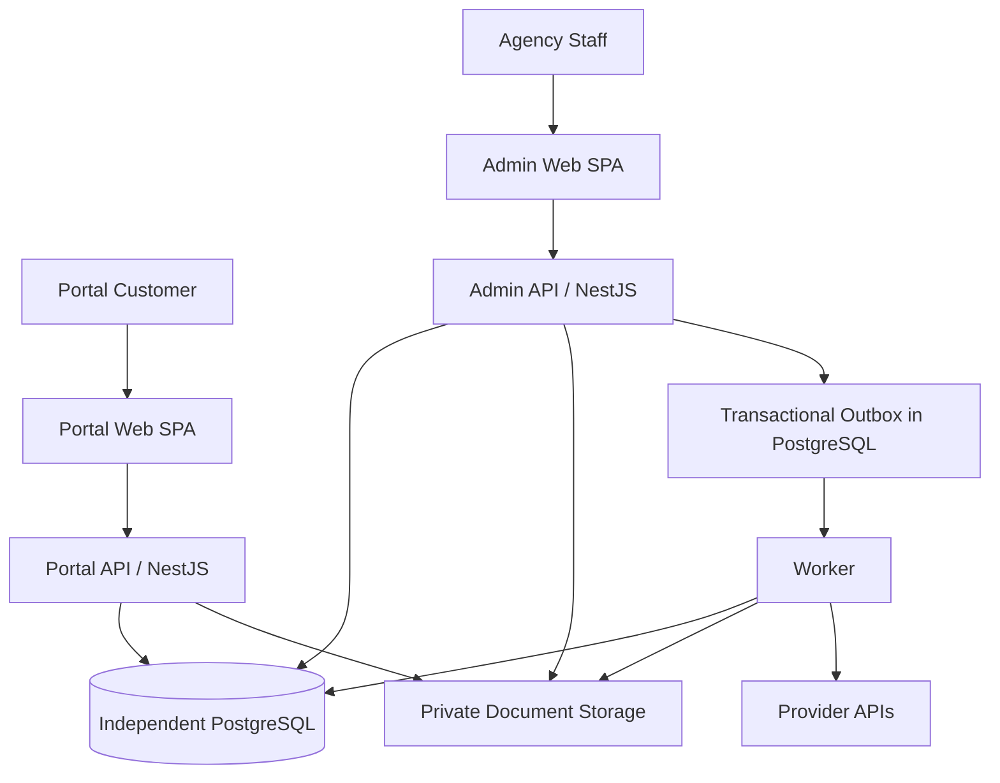

# TravelOS Architecture

**Status:** Accepted — Phase 0 foundation  
**Style:** Modular monolith with separate delivery composition roots

## 1. Architectural drivers

1. A Portal release must be isolated from mutable workspace state.
2. Sensitive identities/documents/financial data require default-deny authorization and audit.
3. One codebase and one migration chain must serve reproducible dedicated deployments.
4. Per-instance runtime footprint matters when fleet size grows.
5. Business policy must remain independent of frontend, NestJS, database library and providers.
6. Background work must survive crashes/retries without distributed-service infrastructure.
7. Data/schema evolution outlives framework choices.

## 2. System context and containers



All boxes except external providers are one TravelOS release and one dedicated instance. Separate processes/composition roots are security and workload boundaries, not independently versioned microservices. There is no synchronous Admin API → Portal API call.

## 3. Final stack decision

| Layer | Decision | Reason/trade-off |
|---|---|---|
| Language/runtime | TypeScript on one pinned active Node.js LTS | Shared contracts/tooling; runtime validation still required |
| Admin Web | React SPA + Vite static build | Authenticated app has no SSR/SEO need; removes a Node web runtime per instance |
| Portal Web | React SPA + Vite static build | Mobile authenticated app; runtime branding/data fetched safely; no per-Agency build |
| API delivery | Two NestJS composition roots: Admin API and Portal API | Nest modules/DI/OpenAPI ergonomics; separate Portal process/DB role enforces data boundary |
| Database | PostgreSQL, one independent DB per instance; exact supported major selected/pinned at M1 bootstrap | Strong transactions/constraints/exact types; avoid accidental host default, then upgrade only as a tested fleet operation |
| Data access | Kysely + `pg` driver | Typed, explicit SQL and transactions with strict mappers; no ORM entity leakage |
| Migrations | `node-pg-migrate`, reviewed deterministic SQL | PostgreSQL-native constraints/indexes and fleet-safe migration control |
| Auth | Two isolated Better Auth instances at Nest adapters | Avoid custom crypto/session implementation while preserving realm separation |
| Workspaces | pnpm workspaces only | Enough package orchestration initially; no demonstrated need for Turborepo |
| UI | Tailwind CSS + owned design-system components; Radix primitives where useful | Constrained implementation and accessibility; shadcn-style source is owned, not a black-box system |
| Validation/contracts | Zod at trust boundaries; OpenAPI generated from canonical API schemas | Runtime safety and one contract owner |
| Tests | Vitest + real PostgreSQL integration tests + Playwright | Fast policy tests plus real constraint/browser evidence |
| Async | Transactional outbox + TravelOS-owned PostgreSQL job executor | One reviewed schema/migration chain and explicit leases without Redis/Kafka/RabbitMQ per CT |
| Edge/process | Caddy + systemd + immutable release directories | Static assets/TLS/proxy and simple native CT operations; no nested container runtime required |
| Observability | Structured JSON, Prometheus/OpenTelemetry-compatible interfaces | Fleet-readable, vendor-neutral telemetry |

Vite's deployment model produces static assets for ordinary static hosting.[1] Next.js can also produce static exports,[2] but using Next solely as a static generator adds framework conventions without using its differentiating server capabilities. Running two Next servers would add memory, patching and cache/runtime state to every CT. Therefore Next.js is rejected for V1. Revisit only if a measured requirement needs SSR, React Server Components, public SEO pages, edge rendering or server-generated social metadata that cannot be satisfied by a small dedicated public surface.

Prisma and Turborepo are rejected as described in `DATA_MODEL.md` and ADR-012/013. Redis, Kafka, RabbitMQ, Kubernetes and a service mesh are explicitly absent.

Graphile Worker was evaluated but is not selected. Its library startup path invokes its internal migrator,[16] and its OSS stale-lock recovery resets locks after a fixed four-hour threshold.[17] That conflicts with TravelOS's controlled single migration chain and per-task bounded lease/deadline model. TravelOS therefore owns a deliberately small PostgreSQL job table/claim protocol; this is not a general workflow engine and does not replace domain events, Audit or the outbox. Reconsider an external queue only through an ADR after measured need.

## 4. Application dependency rule

Each bounded module is a deep module with four conceptual rings:

```text
domain <- application <- adapters <- composition root
```

- Domain: entities, value objects, policies, events; imports only shared kernel primitives.
- Application: commands, queries, repository/provider ports, authorization requirements, transaction boundary intent.
- Adapters: Kysely repositories, provider adapters, Nest controllers/presenters, event/job handlers.
- Composition root: concrete wiring/config/lifecycle.

Source dependencies point inward. DTOs, ORM rows, Nest decorators, HTTP objects and vendor SDK types are forbidden in domain/application code.

### Shared kernel

The shared kernel is deliberately tiny: opaque IDs, Clock interface, Money/Currency primitives, Result/error vocabulary and event metadata. It contains no Agency/Customer/Trip entity, repository, auth, provider or general `utils` dumping ground.

## 5. Module dependency policy

| Consumer | Permitted dependencies |
|---|---|
| Agency Organization | shared kernel only |
| Staff Access | Organization contracts, shared kernel |
| CRM | Organization contracts, shared kernel |
| Sales | CRM stable query contracts, Organization, shared kernel |
| Trip Operations | Sales/CRM stable IDs/snapshots, Organization, shared kernel |
| Customer Presentation write side | Trip/Organization publication-source ports, shared schema registry |
| Portal safe core | Portal Access + Customer Presentation read contracts + safe Document grant port only |
| Finance | Sales/Trip contracts, Money kernel |
| Documents | stable subject IDs, Portal grant contract, StorageProvider port |
| Activity/Audit | event contracts, never module repositories |
| Integrations | ports and anti-corruption maps; core modules do not depend back |

Dependency cycles fail CI via TypeScript project references/package exports plus an import-graph rule (for example dependency-cruiser/ESLint). Portal API has its own allowlist and cannot import workspace module paths.

## 6. API architecture

### Surfaces

- `/api/admin/v1/*` — staff realm, commands and operational queries.
- `/api/portal/v1/*` — Portal realm, active published read models and explicit Portal commands.
- `/api/webhooks/v1/:provider/*` — provider-specific verified ingress adapter.
- `/internal/*` — localhost/private operational health/version only; never exposed publicly.

REST is the V1 external style. GraphQL is unnecessary for the bounded client surfaces and could expand authorization/query complexity.

### Contract rules

- Zod schemas in `packages/contracts` own external shapes and reject unknown input fields.
- Admin and Portal DTOs are independent; “shared Trip DTO” is forbidden.
- OpenAPI is generated in CI from canonical schemas and diffed for breaking changes.
- Errors follow Problem Details-style shape with stable TravelOS code, safe detail and correlation ID.
- Mutations accept expected `lockVersion`/workspace revision and return `409` on conflict.
- Retryable commands use `Idempotency-Key`; response state is stored by Agency/principal/operation.
- Cursor pagination is mandatory; no unbounded list.
- External timestamps are RFC 3339 with zone semantics separately represented for scheduled travel.
- Money amounts and bigint IDs/counters are strings in JSON.
- API versions do not expose database/schema/provider versions.

## 7. Composition roots and database credentials

### Admin API

Owns staff authentication, authorized workspace commands/queries, preview/publish commands and Admin document operations. It has an Admin runtime pool, not migration-owner credentials.

### Portal API

Owns Portal authentication, active-publication reads, TripAccessGrant evaluation and grant-safe document downloads. It uses a Portal-restricted PostgreSQL role and cannot query workspace schemas. Its package graph exposes no workspace repository.

### Worker

Owns outbox dispatch, TravelOS job execution, provider calls, scans, notifications, backfills and projections. Each handler receives only the ports/credentials it needs. Queue backlog cannot block synchronous Admin/Portal health unnecessarily.

## 8. Transactions and concurrency

- One command transaction may update one aggregate and atomic supporting records/outbox/audit.
- Cross-aggregate invariants use explicit locking/serializable isolation where required; other reactions are eventual.
- Ordinary edits use optimistic `lock_version` compare-and-swap.
- Publication uses a serializable transaction and Trip coordinator lock as specified in `PUBLISHING_MODEL.md`.
- External network/file delivery never occurs inside the database transaction.
- Kysely transaction objects do not enter domain code; a UnitOfWork/transaction runner application port coordinates repositories.
- Every transaction has bounded timeout and no user interaction.

## 9. Events, outbox and jobs

### Event envelope

```text
messageId, eventName, schemaVersion, occurredAt,
agencyId, aggregateType, aggregateId, correlationId,
causationId, payload
```

Payloads are minimal, versioned and classified. Integration event schemas are backward-compatible within the supported release window.

### Transactional outbox

Business state, domain-event representation and immutable outbox message commit together. A dispatcher claims messages using bounded leases. Per-consumer delivery records permit independent retries. Delivery is at-least-once; “exactly once” is not claimed.

Handlers must use one or more:

- unique natural/external event key;
- inbox/message ID record;
- idempotent upsert/state transition;
- provider idempotency key and persisted response;
- compare-and-swap expected state.

### PostgreSQL job executor

The TravelOS Worker handles delayed/scheduled/retryable commands using TravelOS-owned tables in the same PostgreSQL instance. Job payloads contain IDs and schema version, not complete sensitive aggregates. Logical queues separate critical publication/document/security work from low-priority notifications/reporting.

Policy:

- exponential backoff with jitter and bounded attempts/deadline;
- per-job lease duration derived from a declared task maximum, renewable heartbeat and hard execution deadline;
- explicit concurrency per task/provider;
- dead-letter/quarantine state with operator retry/cancel UI later;
- compare-and-swap claim/heartbeat/complete transitions using database time; a stale worker cannot complete a lease it no longer owns;
- graceful shutdown stops claiming, lets bounded work finish and explicitly releases or allows lease expiry;
- reaper retries an expired lease only after handler reconciliation/idempotency preconditions pass; otherwise it moves the job to `UNKNOWN_OUTCOME` quarantine;
- recurring tasks use stable keys to prevent duplicate schedules;
- outbox age and dead jobs are health metrics.

Publication commit succeeds even if notification fails. Notification retries never create another publication.

## 10. Provider architecture

Capability ports include `StorageProvider`, `MalwareScanProvider`, `NotificationProvider`, `CommunicationProvider`, `PaymentProvider`, `FlightProvider`, `AccommodationProvider`, `AccountingProvider` and `CalendarProvider`.

Rules:

- ports use TravelOS capability language, not vendor resource models;
- adapters translate via anti-corruption layers;
- domain IDs differ from provider references;
- provider config is typed and refers to secrets by identifier;
- manual/no-provider operation is a first-class adapter;
- inbound webhook inbox and outbound idempotency/reconciliation are mandatory;
- every effectful call has a persisted TravelOS operation ID/business key and request hash before first dispatch;
- provider-enforced idempotency under that stable key is preferred; otherwise the adapter must implement a durable read-after-write lookup that resolves ambiguous outcomes before retry;
- an adapter that can neither guarantee idempotency nor reconcile a potentially successful effect is manual/disabled for that capability;
- canonical provider errors are `INVALID_REQUEST`, `AUTHENTICATION`, `RATE_LIMITED`, `TEMPORARY`, `PERMANENT`, `CONFLICT`, `UNKNOWN_OUTCOME`;
- fake adapters and conformance suites test the port contract;
- switching provider changes configuration/adapter, not core schema or customer fork.

## 11. Activity Timeline and Audit Log

Activity is an eventually consistent product projection from selected domain events plus authorized manual notes. It is human-readable, can be filtered by product visibility, and can be rebuilt where its source remains.

Audit is insert-only security/accountability evidence written synchronously for sensitive commands/outcomes. It has stricter access/retention and is not editable/rebuildable from Activity. Neither replaces structured domain state or application logs.

## 12. Repository structure

```text
TravelOS/
├── apps/
│   ├── admin-web/             # React/Vite static SPA
│   ├── portal-web/            # React/Vite static SPA
│   ├── admin-api/             # NestJS staff composition root
│   ├── portal-api/            # NestJS restricted Portal composition root
│   └── worker/                # PostgreSQL jobs/outbox composition root
├── packages/
│   ├── backend-core/
│   │   └── src/modules/       # bounded modules; internal exports restricted
│   ├── portal-safe-core/      # presentation/grant-safe query surface only
│   ├── contracts/             # independent Admin, Portal, event schemas
│   ├── database/              # Kysely adapters/types + migration runner
│   ├── auth-adapters/         # isolated Better Auth integrations
│   ├── design-system/         # tokens and accessible owned primitives
│   ├── config/                # typed external config schemas
│   ├── observability/         # logger/metrics/tracing ports/adapters
│   └── test-support/          # factories/harnesses; no production import inward
├── migrations/                # one ordered reviewed fleet migration chain
├── deploy/
│   ├── caddy/
│   ├── systemd/
│   ├── manifests/
│   └── automation/            # declarative provisioning/upgrade inputs
├── tooling/                   # lint/type/architecture/test configuration
├── docs/
│   ├── adr/
│   └── reviews/
├── AGENTS.md
├── pnpm-workspace.yaml
└── package.json
```

This is a proposed Phase 1 structure; Phase 0 does not create application directories/configuration. One package per tiny class/context is avoided. Package exports and architecture tests provide hard boundaries where security demands them.

Turborepo may be reconsidered when CI measurements show material repeated-build cost, remote caching is needed, or more than roughly five deployable graphs become difficult with `pnpm --filter`. Popularity is not a trigger.

## 13. Testing strategy

| Layer | Required evidence |
|---|---|
| Domain unit/property | Money arithmetic/allocation, state machines, visibility resolution, permissions, invariants |
| Architecture | forbidden imports, cycle-free modules, Portal package/DB access allowlist |
| Database integration | real pinned PostgreSQL; constraints, transactions, optimistic conflicts, role privileges |
| Contract | Zod/OpenAPI compatibility, snapshot schema/golden fixtures, provider conformance |
| Security | realm confusion, CSRF, IDOR, scope, revocation, INTERNAL_ONLY sentinels, document grants |
| Jobs | duplicate/delayed/reordered delivery, lease ownership/heartbeat, crash after external success before local commit, reconciliation, dead-letter/replay |
| Migration | empty + supported prior versions + representative volume; app/schema compatibility |
| Browser | Playwright desktop/mobile/no-JS auth, preview/publish v1/v2, console/network/accessibility |
| Operations | release install, host-boundary probes, health, upgrade/rollback, encrypted backup/restore, retention expiry and privacy-deletion reconciliation |

Tests use deterministic clocks/IDs where appropriate and disposable synthetic data. Unit mocks never substitute for PostgreSQL constraint/privilege tests. Every production bug adds the lowest-level reliable regression plus end-to-end coverage when a boundary failed.

## 14. CI strategy

The intended pipeline, not implemented in Phase 0:

1. lockfile/frozen install and provenance check;
2. formatting, lint, secret scan and architecture dependency check;
3. typecheck and domain/unit/property tests;
4. start pinned disposable PostgreSQL; run empty/prior migration matrices and role tests;
5. integration, contract, auth/security and job failure tests;
6. build all five deployables/static bundles;
7. Playwright critical flows at desktop/narrow mobile, accessibility and no-JavaScript credential safety;
8. dependency/license/SBOM and artifact vulnerability scanning;
9. create one immutable release tarball, checksums, manifest and provenance; sign it;
10. publish once, then promote the same digest through environments.

Main is protected. Required checks and independent review block merge. CI credentials are short-lived/least privileged. A customer build matrix is forbidden because customer differences are runtime configuration.

Initial CI provider assumption is GitHub Actions; the contract remains expressible as scripts so the provider can change. No workflow is created in Phase 0.

**Steady state (ADR-016):** `pnpm check` runs `tooling/ci/verify-current.mjs`, a list of current-tree gates and the only gate. It includes the classified current-source sensitive-data scan (`tooling/ci/scan-current-source.mjs` + `tooling/ci/current-source-findings.json`) and the unified PostgreSQL suite (`pnpm test:db`). Steps 7–10 above (Playwright in CI, SBOM/vulnerability scanning, signed release promotion) are not currently planned.

## 15. Observability

### Logs

Structured JSON fields: timestamp, level, service/process, environment, instance ID, release/schema/config version, module, request/trace/correlation ID, pseudonymous principal ID/type, action, outcome, error code and duration. Redaction is allowlist-based; no token, credential, document content, raw provider payload, sensitive itinerary/finance value or unnecessary PII.

### Metrics

RED for HTTP/process and USE for resources, plus:

- authentication failure/lockout/MFA challenge;
- authorization denial by safe reason;
- publication attempts, stale conflicts, success/failure and duration;
- outbox oldest age, pending count, retries/dead letters;
- jobs by task/outcome/duration/lease expiry;
- database pool/saturation/slow bounded query;
- document quarantine/scan failures;
- provider latency/error/circuit state;
- backup age/restore-verification age;
- release/schema/config mismatch and disk/storage quota.

Labels use stable low-cardinality instance/process/event names; customer names/emails/IDs are not metric labels.

### Tracing and health

Propagate W3C trace/correlation context through HTTP/outbox/jobs. OpenTelemetry-compatible instrumentation is used when it provides cross-boundary value; no collector is required per CT initially.

- `/health/live`: process loop only; never restarts due to downstream outage.
- `/health/ready`: required database/config/schema/storage readiness for that process.
- `/internal/version`: release digest, schema/config compatibility and feature manifest, bound privately.
- deep diagnostic is authenticated/operator-only and never leaks credentials.

Alert on user-impact/SLO burn, publication failures, old outbox, dead jobs, backup age and disk pressure—not arbitrary CPU alone.

## 16. Scalability and extraction criteria

Scale dedicated instances vertically first. Static UIs and no broker/cache minimize per-CT footprint. Add cache/read replicas only from measured pressure. A bounded context may become a service only when it has independently scaling/availability/compliance needs, a stable contract and operational ownership that outweigh network/distributed-data cost. Database size alone does not trigger microservices.

Future fleet automation is enabled by release/instance manifests, health/version endpoints, uniform schema chain and external configuration. The Control Plane remains unimplemented.

## 17. Traceability matrix

| Required topic | Canonical section/document |
|---|---|
| Product architecture/scope | Product Blueprint; Architecture §§1–3 |
| Domain boundaries/model | Domain Model |
| Data/finance/migrations | Data Model |
| Dedicated deployment/organization | Deployment Model; Domain Model |
| Authentication/permissions/identity | Permissions; Security Model |
| Publishing/itinerary/reservations | Publishing Model; Domain/Data Model |
| Documents/security | Security Model; Data Model |
| Activity/audit | Architecture §11; Data Model §10 |
| Jobs/outbox/providers | Architecture §§9–10 |
| Repository/environments/testing/CI | Architecture §§12–14; Deployment Model |
| Logging/observability | Architecture §15 |
| ADRs/constitution | `docs/adr/`; root `AGENTS.md` |

## 18. Architecture quality assessment

**Accepted Phase 0 foundation score: 9/10.** It uses a modular monolith, deep boundaries, explicit trade-offs and a low per-instance dependency count. The final independent reviewer verified the 37-entry post-PO freeze byte-for-byte, closed TOS-AR-001 through TOS-AR-005 and TOS-INT-001/002, found no new BLOCKER/HIGH and confirmed that no Product Owner decision remains open. Phase 0 is therefore technically closed. Reaching 10/10 requires executable evidence rather than more speculative design: M1 must prove auth-realm isolation, Portal database privileges, host rejection, document reauthorization, job lease/CAS and `UNKNOWN_OUTCOME` reconciliation, migration drift controls and artifact footprint; pre-production must prove encrypted restore/expiry/deletion reconciliation and legal/privacy plus threat-model acceptance of residual backup windows.

## Sources

[1] https://vite.dev/guide/static-deploy.html  
[2] https://nextjs.org/docs/app/guides/static-exports  
[16] https://github.com/graphile/worker/blob/main/src/lib.ts  
[17] https://github.com/graphile/worker/blob/main/src/sql/resetLockedAt.ts
