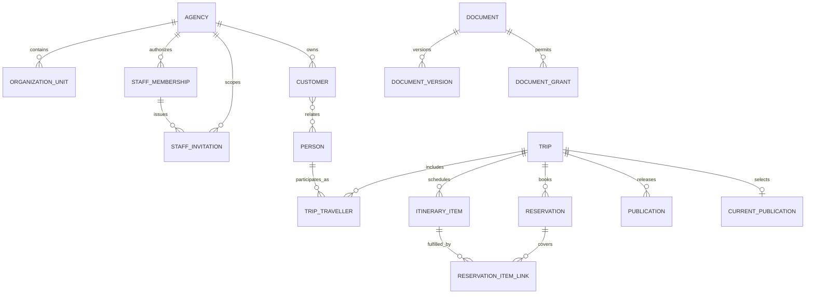

# TravelOS Data Model and Migration Policy

**Status:** Accepted — Phase 0 foundation  
**Governing ADRs:** ADR-003, ADR-005, ADR-010, ADR-012, ADR-014

## 1. Strategy

PostgreSQL is the single system of record per dedicated instance. The model is relational and constraint-first because TravelOS has durable identities, many-to-many relationships, exact financial facts, historical versions and strong consistency requirements.

Core/queryable domain data uses typed columns and relations. JSONB is limited to:

- immutable versioned publication payloads validated against a named schema;
- bounded provider/webhook payloads retained at the integration boundary with classification/retention controls;
- versioned extension data for `Other` itinerary items;
- non-authoritative safe metadata where access patterns do not require relational constraints.

JSONB must not replace typed money, permissions, identity, Reservation–Item links, audit envelope, or common itinerary family fields.

## 2. Persistence technology

Use Kysely as a thin typed SQL query builder and `node-pg-migrate` as the reviewed migration runner. Kysely exposes explicit SQL/transactions rather than a mutable ORM entity graph, and its own migration mechanism exists but is intentionally not the production schema authority.[3] `node-pg-migrate` provides TypeScript/programmatic support and direct PostgreSQL schema/SQL operations; its migrations are transactional by default unless a migration explicitly opts out.[8][9]

Prisma is not selected. Prisma can customize generated migration SQL,[4] but its schema-first/generated-client workflow adds a second schema abstraction and encourages persistence records to become application models. TravelOS instead prioritizes explicit PostgreSQL constraints, reviewed SQL, deterministic fleet migrations and strict domain mapping over CRUD convenience.

Rules:

- repository ports live with application/domain policy;
- Kysely, PostgreSQL row shapes and migration types live in infrastructure/database packages;
- every repository maps rows to domain objects/value objects explicitly;
- no Kysely row, database enum, generated database interface or raw JSON crosses an application/API boundary;
- complex read models may use explicit query services without reconstructing aggregates;
- database types are generated/introspected for developer feedback, never used as domain contracts.

## 3. Identifier, scope and time conventions

- Application-generated UUIDv7 identifiers, PostgreSQL `uuid`, are used for durable entities. They are opaque identifiers, not authorization.
- Every Agency-owned table includes non-null `agency_id`, even with a dedicated database.
- Tables expose `UNIQUE (agency_id, id)` so composite foreign keys can prove same-Agency references.
- Trip-owned tables additionally support `UNIQUE (agency_id, trip_id, id)` where cross-table Trip equality must be enforced.
- All mutable aggregate roots have `lock_version bigint NOT NULL DEFAULT 0`; updates use `WHERE lock_version = expected` and increment atomically.
- `created_at`/`updated_at` are `timestamptz`; business local dates use `date`; local scheduled travel uses `date` + `time` + IANA `timezone_name` + derived `instant timestamptz` where determinable.
- IDs, times, decimals and Money minor units cross JSON as strings where JavaScript precision could be lost.
- Database/application time is UTC. Display zone is explicit and never inferred from server locale.
- Enumerations with durable business meaning use text plus CHECK/lookup ownership and additive evolution; PostgreSQL enum types are avoided where fleet-safe removal/renaming would be difficult.

## 4. Logical schemas and ownership

| Schema | Representative tables | Owner |
|---|---|---|
| `organization` | `agency`, `organization_unit`, `team`, `team_member`, `branding_draft` | Agency Organization |
| `staff_access` | auth-library-prefixed staff tables, `staff_membership`, `role`, `role_permission`, `role_assignment`, `permission_registry_version`, `staff_invitation` | Staff Access |
| `crm` | `person`, `customer`, `customer_person`, `traveller_group`, `traveller_group_member`, contact/address tables | CRM |
| `sales` | `lead`, `lead_idempotency`, `travel_request`, `opportunity`, `quote`, `quote_version`, `proposal_alternative`, `sale` | Sales |
| `trip_ops` | `trip`, `trip_traveller`, `itinerary_item`, family detail tables, `journey_group`, `reservation`, `reservation_item_link` | Trip Operations |
| `presentation` | `publication`, one-to-one `publication_payload`, `current_publication`, `publication_event`, `agency_profile_publication` | Customer Presentation |
| `finance` | `price_line`, `cost_line`, `fee`, `commission`, `payment`, `payment_allocation`, `exchange_rate` | Finance Operations |
| `documents` | `storage_object`, `document`, `document_version`, typed association tables, `document_grant` | Documents |
| `work_service` | `task`, `case`, assignment/state history | Work & Service |
| `communications` | `conversation`, `message`, `delivery_request` | Communications |
| `activity` | `activity_entry`, `lead_entry` | Activity |
| `audit` | `audit_event`, `staff_invitation_event`, `lead_event` | Audit |
| `integration` | `provider_config`, `provider_reference`, `webhook_inbox`, `outbox_message`, `outbox_delivery`, `lead_outbox` | Integrations |
| `job_runtime` | `job`, `job_attempt`, `recurring_job_key` | TravelOS Job Runtime |

Authentication-library tables (Staff realm only) are physically separate from application tables. The former customer-login schema, Trip access grants and runtime-acceptance fixture tables were dropped by migration 0018 (ADR-016).

### Stage 9 Staff invitations

| Record/data | Owner and classification | Customer-facing eligibility | Retention, audit and access |
|---|---|---|---|
| `staff_access.staff_invitation` | Staff Access. `targetEmail` is Staff-access PII; `tokenDigest` is restricted authentication material (lowercase SHA-256 digest only); identifiers and lifecycle timestamps are internal operational data. | None. There is no customer-facing contract or database privilege for this table. | Pending tokens expire after 60 minutes; expiry is not a record-retention period. The migration defines no automatic purge: terminal invitation metadata/digests remain subject to the privileged, policy-controlled retention/deletion process. Every issue, reissue, revoke, expiry and consume transition has a same-transaction audit event. The Admin runtime uses Agency-scoped permission `staff.invite` with recent MFA; list pages are bounded/keyset-paginated by Agency and ID, expiry scans use Agency/status/expiry, and acceptance looks up the unique digest. |
| `audit.staff_invitation_event` | Audit. Agency/invitation/actor identifiers, event type and timestamp only; no email, raw token, digest, password, MFA seed or recovery code. | None. There is no customer-facing contract or database privilege for this table. | Append-only, retained under the privileged Audit retention policy. A restricted Admin runtime may select/insert; mutation and truncation are denied. Foreign keys bind invitation, related invitation and actor to the same Agency; retention/deletion must reconcile linked invitation and audit rows together. |

The 60-minute expiry limits token use, not how long the invitation email or digest is retained. This Stage 9 extension introduces no numeric post-terminal retention period; the existing privileged retention policy remains authoritative and must be followed before any purge.

The only Stage 9 inviteable role is the code-owned Agency template `trip-operations-v1`; callers cannot choose a role ID or permission set. Acceptance locks and validates the pending invitation, creates the Better Auth Staff identity and its controlled email-verification state, inserts the active Agency membership and fixed role assignment, consumes the invitation, and appends the immutable audit event in one transaction. Any failure rolls back the complete operation. The issuer-approved email binding is not independent proof of mailbox ownership. No session is issued by enrolment, and Staff authorization context remains unavailable until TOTP MFA is enabled and verified. No customer-facing role has access to invitation or invitation-audit data.

### M2 slice 1 Sales Lead

| Record/data | Owner and classification | Customer-facing eligibility | Retention, audit and access |
|---|---|---|---|
| `sales.lead` (`id`, `agencyId`, `source`, `contactGivenName`, `contactFamilyName`, `contactEmail`, `contactPhone`, `internalNote`, `state`, `qualifiedCustomerId`, `disqualificationReason`, `lockVersion`, `createdAt`, `updatedAt`, `closedAt`) | Sales. Contact fields are `CONFIDENTIAL_PERSONAL`; `internalNote` is `INTERNAL_ONLY`; `source`, `state`, reason, identifiers, version and timestamps are internal operational data. | None. No customer-facing contract, source field or override exists; no customer-facing runtime has a schema or table privilege on `sales`. | Retained after qualification and follows the CRM retention/privacy-deletion policy; privacy deletion of a Lead is a later slice and there is no blanket soft delete. Qualify and disqualify are audited. The Admin runtime has `SELECT`, `INSERT`, `UPDATE` (no `DELETE`/`TRUNCATE`); a trigger rejects any update of a closed Lead, any lock-version step other than +1 and any change of identity or creation time. Access: Agency-scoped cursor listing by `(agencyId, state, createdAt DESC, id DESC)` and point reads by `(agencyId, id)`. |
| `sales.lead_idempotency` | Sales. Agency, Staff principal, command (`lead.create`, `lead.qualify`, `lead.disqualify`), caller key and a SHA-256 request hash; no contact data. | None. | Immutable. Read by the exact primary key `(agencyId, staffPrincipalId, command, idempotencyKey)`; retention follows the Lead it references. |
| `audit.lead_event` | Audit. Agency, Lead, actor, action (`LEAD_QUALIFIED`/`LEAD_DISQUALIFIED`), lock-version step, the linked Customer ID or the categorical reason; never contact data or the note. | None. | Append-only with mutation and truncation rejected for every role; at most one closure event per Lead. Retained under the privileged Audit retention policy and reconciled with the Lead on privacy deletion. |
| `activity.lead_entry` | Activity. Agency, Lead, actor, entry type and instant; a human-readable line is rendered from these identifiers, never stored with contact data. | None. | Append-only; written synchronously with the audit event because the Stage 8 `ACTIVITY_V1` projection is Trip-scoped. Read by `(agencyId, leadId, occurredAt)`. |
| `integration.lead_outbox` | Integrations. Message ID, Agency, Lead, audit reference, `LeadQualified`/`LeadDisqualified`, schema version 1 and the new lock version only. | None. | Immutable, inserted in the business transaction; no delivery consumer exists yet (delivery is deferred, like the earlier publication outboxes). |

`sales.lead` references its Customer through the composite same-Agency key `(qualifiedCustomerId, agencyId)` with `ON DELETE RESTRICT`; the history tables reference the Lead, the actor membership and the Customer the same way. Check constraints bind `state` to `qualifiedCustomerId`, `disqualificationReason` and `closedAt` (`QUALIFIED` iff a Customer, `DISQUALIFIED` iff a reason, `OPEN` iff no `closedAt`) and bound every text field (names 1–200, email at most 320, phone at most 40 using digits, spaces and `+()-`, note at most 4000). `lockVersion` starts at 1 for this table, as for the other M1 aggregates.

## 5. Core relationship model



`Customer–Person` is an explicit relationship with commercial/contact roles. `TripTraveller` references Person but stores trip-specific participation.

## 6. Itinerary and Reservation storage

### Common item

`trip_ops.itinerary_item` contains common identity/scope, `family`, lifecycle state, ordering key, traveller applicability mode, common timing/location summary, publication-relevant presentation draft and `lock_version`.

Each family has one typed detail table keyed by `(agency_id, trip_id, item_id)`:

- `flight_item_detail`
- `accommodation_item_detail`
- `transfer_item_detail`
- `activity_item_detail`
- `insurance_item_detail`
- `vehicle_rental_item_detail`
- `rail_item_detail`
- `ferry_item_detail`
- `cruise_item_detail`
- `other_item_detail`

A deferred constraint trigger validates exactly one matching family detail row before commit. Family-specific CHECK constraints validate timing and required fields. Type changes use an explicit conversion command in one transaction; generic updates cannot change the discriminator.

Multi-segment services are multiple independent items. `journey_group_item` gives ordering/group presentation without changing item identity.

### Reservation link

`reservation_item_link` includes `agency_id`, `trip_id`, `reservation_id`, `itinerary_item_id`, link role and optional allocation metadata. Composite foreign keys enforce that Reservation and Item belong to the same Agency and Trip. Primary key prevents duplicate links.

No reservation details are copied into item internals merely for UI convenience. Customer-facing booking references are deliberately projected from safe reservation presentation fields at publication time.

## 7. Publishing storage

`presentation.publication` contains immutable publication metadata and `publication_payload` contains the one-to-one canonical versioned snapshot while retained:

- `UNIQUE (agency_id, trip_id, version)`;
- `UNIQUE (agency_id, idempotency_key)` at the command scope;
- source revision, schema version and content hash;
- publisher/correlation metadata;
- schema version, canonical content hash and payload-presence metadata;
- `publication_payload.payload jsonb` is validated against the named application snapshot schema before insertion and has a same-publication/same-Agency foreign key;
- Runtime roles have no UPDATE/DELETE privilege on publication metadata or payload.

`current_publication` has one row per Trip and a same-Agency/Trip composite FK to Publication. Publish updates it in the same serializable transaction as insertion.

`publication_event` records activation, supersession, withdrawal and privacy payload deletion. A narrowly privileged security-definer command verifies authority/legal hold, clears the current pointer if necessary, deletes only the separate payload row and appends `PRIVACY_PAYLOAD_DELETED` in one transaction. It cannot rewrite payload fields or publication metadata. Routine runtime roles cannot call it.

A future share link (ADR-016) reads only the frozen snapshot behind an active pointer; it cannot enumerate historical rows or read workspace schemas. The presentation adapter verifies the canonical content hash and parses the declared snapshot schema before returning a customer DTO. Payloads are never materialized into a static asset or generic cache.

## 8. Exact financial representation

PostgreSQL distinguishes exact `numeric/decimal` from inexact floating types.[7] TravelOS uses two exact representations:

### Money

```text
Money = { minorUnits: bigint, currency: ISO4217Code, scale: pinned currency metadata }
```

- PostgreSQL: `amount_minor bigint NOT NULL`, `currency_code char(3) NOT NULL` with FK to a versioned platform currency registry.
- TypeScript domain: `bigint`, never `number`.
- API/publication: decimal-free integer string plus currency, or a formatted decimal string produced by the Money formatter; never a JSON numeric amount.
- Addition/subtraction requires identical currency.
- Multiplication, allocation, tax, percentage, exchange and division produce high-precision `Decimal` intermediate values and an explicit rounding operation.

### Rates and percentages

- PostgreSQL `numeric(30,15)` for exchange rates and `numeric(18,12)` for rates/percentages, after validating positive/range invariants.
- TypeScript uses `decimal.js` with centrally configured precision and an explicit versioned rounding-policy registry; there is no universal implicit rounding mode.
- Binary floats and implicit casts are forbidden in SQL, domain, API, UI calculations and tests.

### Rounding

`ROUND_HALF_UP` is the V1 default only for ordinary commercial pricing when no specialist rule applies. Tax/fiscal calculations, foreign exchange, payment rails/allocation, supplier settlement and accounting exports must select their explicit jurisdiction/provider/accounting policy and may not silently fall back to the commercial default. If the required policy is unknown, the operation fails rather than guesses.

Intermediate calculations do not round opportunistically. Allocation uses an explicitly selected allocation policy; where largest remainder applies it uses a deterministic stable tie-break and asserts allocated sum equals source Money exactly. Every material result records an immutable policy identifier/version and rounding boundary on the financial version.

### History

Original and converted Money are both retained with rate, source, effective time and rounding policy. Quote Versions/Sales store immutable priced lines; margin is derived from frozen inputs and may be cached with provenance. Recalculation never rewrites an accepted historical basis.

## 9. Documents

- `storage_object`: opaque provider object ID, byte size, detected media type, SHA-256 checksum, provider/encryption-control metadata and creation state; bytes are immutable. No domain/API contract contains a filesystem path.
- `document`: Agency, classification, title and lifecycle; no filesystem path exposed.
- `document_version`: ordinal, StorageObject, uploader, original filename (protected metadata), scan result/version, quarantine/availability.
- Typed association tables such as `trip_document`, `traveller_document`, `reservation_document`; avoid a generic unconstrained polymorphic foreign key.
- `document_grant`: Principal, Document and optional fixed version, capability, expiry/revocation, issuer and reason; unique active-grant rules.

Only AVAILABLE versions can be returned by grant-safe query services. Removing a grant never deletes the underlying audit/history.

Document privacy deletion revokes active grants and transitions the version to `DELETING` in the database before calling `StorageProvider.delete(opaqueObjectId)`. Provider deletion/head is idempotent. Confirmation moves metadata to `DELETED` and removes the active object reference while retaining only lawful safe evidence. Reads fail closed throughout; retry resumes the state machine after a crash. Older encrypted backup copies remain governed by ADR-014 retention and restore reconciliation.

## 10. Activity, audit, events, outbox and jobs

| Record | Mutable? | Purpose | Payload rule |
|---|---|---|---|
| ActivityEntry | Append-only; correction entry allowed | Human-readable operational timeline | Curated safe text/structured references |
| AuditEvent | Insert-only; retention-controlled by privileged policy | Security/accountability | Safe identifiers, action/outcome/change-field names; no secrets/full documents |
| DomainEvent | Immutable transient/in-process fact persisted through outbox where async | Domain reaction | Versioned domain fact |
| OutboxMessage | State machine metadata mutable; event payload immutable | Reliable post-commit delivery | Versioned integration envelope |
| TravelOS Job | Runtime state mutable under lease CAS | Retry/schedule/execute background command | Reference IDs, not large sensitive aggregates |

`outbox_message` is inserted in the business transaction. `outbox_delivery` is per consumer, so one failed consequence does not make another look undelivered. TravelOS-owned `job_runtime.job` uses state, `run_at`, bounded attempt/deadline, `lease_owner`, `lease_expires_at`, heartbeat timestamp and version; claims use database time, `FOR UPDATE SKIP LOCKED` and compare-and-swap completion. No dependency owns or mutates a parallel job schema. Every effectful handler is idempotent or reconciles a durable business key before retry. Published external events never expose internal row structures.

Audit runtime role can INSERT and SELECT only per policy; UPDATE/DELETE is denied and guarded. Periodic signed export checkpoints to off-instance storage provide tamper evidence against application-role compromise. Database-owner compromise remains an operational threat addressed by least privilege and off-instance backups/checkpoints, not a false “cryptographically impossible” claim.

## 11. Deletion and retention

There is no blanket `deleted_at` convention.

- Mutable operational records use explicit lifecycle/archive states when recovery is meaningful.
- Authentication tokens/sessions and transient inbox/outbox records are hard-deleted after retention.
- Legal/commercial/audit facts use correction events and policy retention.
- PII/document/publication deletion uses privileged idempotent workflows that remove the active payload, respect legal holds and preserve only lawful minimal evidence.
- Database, private storage and off-instance backups are encrypted at rest with access-separated recovery secrets and bounded approved retention. A pre-deletion backup may retain a recoverable copy until expiry; restores stay network-closed while known deletion records are reconciled. TravelOS does not claim immediate backup-side erasure.
- Every table is classified with retention owner before implementation.
- Foreign-key cascades are allowed only for genuinely dependent ephemeral children; business history uses RESTRICT or explicit commands.

## 12. Index policy

Every index cites an access pattern in the migration review. Initial patterns include:

- Agency + status/updated time for operational lists;
- Trip + item order/time;
- Customer/Person normalized search keys with privacy-conscious indexing;
- current publication by Agency/Trip;
- outbox pending by next-attempt/lease;
- audit by Agency/time and target;
- provider inbox by provider/external event ID.

Unbounded list queries are forbidden; cursor pagination uses stable `(sort_value, id)` keys. Partial indexes target active/pending records. Partitioning is deferred until table size/retention evidence justifies it; audit/activity/outbox are designed so time partitioning can be added.

## 13. Migration policy

### Source and identity

- One monotonic, immutable migration chain for all instances.
- Filenames use timestamp/sequence plus description and include a checksum in the release manifest.
- No customer-specific migration, branch, condition on customer identity, manual post-deploy SQL or edited applied file.
- Applied migration checksum drift is a deployment BLOCKER.
- Migrations and application version compatibility are machine-readable.
- TravelOS owns every schema change, including both Better Auth realms and `job_runtime`; runtime dependency CLIs/initializers cannot mutate schema.

### Change protocol

1. classify lock, rewrite, data volume, rollback and compatibility risk;
2. author explicit migration and inspect generated/final SQL;
3. test from empty database and each supported prior release with representative volume/data edge cases;
4. when a Better Auth dependency/config/plugin changes, generate its Staff SQL into review-only temporary output, inspect/adapt it into an ordinary TravelOS migration, and fail CI if the declared auth schemas no longer conform; Better Auth documents SQL generation for its built-in Kysely adapter,[13] while `auth migrate` is forbidden in TravelOS deployment/startup;
5. use expand → backfill → verify → switch reads/writes → contract across releases for incompatible changes;
6. keep backfills resumable, idempotent, bounded and observable; run large work as a controlled job, not an unbounded migration transaction;
7. set `lock_timeout` and `statement_timeout`; fail rather than surprise-lock an instance;
8. require verified backup/restore point and disk headroom before destructive/high-risk migration;
9. run preflight, place affected process in maintenance/read-only mode when required, migrate once, then start/health-check;
10. rollout dev → staging → internal/canary Agency → batches; halt automatically on failure/SLO regression;
11. contract only after every fleet instance has crossed the compatibility boundary and rollback window has expired.

### Transactions and non-transactional operations

Migrations are transactional by default.[9] An explicit non-transactional migration is exceptional (for example concurrent index work), has one operation, restart detection, pre/postconditions and recovery instructions. It cannot be bundled with unrelated DDL.

### Rollback

Operational rollback is application release rollback only while schema compatibility permits. Data rollback is restore/forward-fix; automatic “down” migrations are not trusted for destructive changes. Every high-risk migration records:

- last compatible app versions;
- restore point ID;
- roll-forward repair;
- rollback deadline;
- operator decision tree.

### Supported version window

An instance may upgrade only from the current or immediately previous supported release unless an explicitly tested multi-hop path exists. Fleet inventory prevents skipping required expansion releases.

## 14. Data-model acceptance gate

BLOCKER conditions include float Money, implicit specialist-context rounding, mutable publication payload through routine runtime credentials, unencrypted database/private-storage/backup media, customer-facing workspace privilege, missing same-Agency/Trip foreign keys, dependency-owned runtime migration, unreviewed SQL, customer-specific migration logic, opaque core JSON or an inability to render retained snapshot versions after migration. Before production, an unapproved retention/deletion policy or an unaccepted residual backup window is also a BLOCKER.

## Sources

[3] https://www.kysely.dev/docs/migrations  
[4] https://www.prisma.io/docs/orm/prisma-migrate/workflows/customizing-migrations  
[7] https://www.postgresql.org/docs/current/datatype-numeric.html  
[8] https://salsita.github.io/node-pg-migrate  
[9] https://salsita.github.io/node-pg-migrate/migrations  
[13] https://www.better-auth.com/docs/concepts/database
