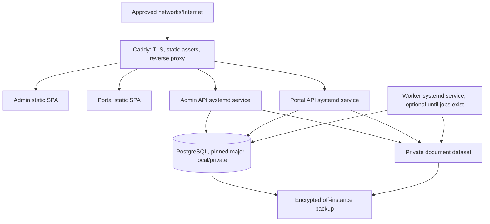

# TravelOS Dedicated Deployment Model

**Status:** Accepted — Phase 0 foundation  
**Governing ADRs:** ADR-002, ADR-003, ADR-012, ADR-013, ADR-014

## 1. Unit of isolation

Default production unit:

```text
one customer Agency
→ one dedicated TravelOS instance
→ one Proxmox CT
→ one independent PostgreSQL database
→ one private document dataset/provider namespace
```

All instances run the same signed release artifact and ordered migration chain. Customer variation is runtime configuration, published branding, entitlements and provider adapters. Source edits, patched artifacts, conditional migrations and customer branches are forbidden.

CT 200 (`travelos-dev`, `192.168.1.200`) is DEVELOPMENT only. Phase 0 does not inspect or alter it because no architecture decision requires host-specific facts.

## 2. Per-instance topology



Only Caddy is network-exposed. PostgreSQL is local/private and not published. Internal health/version endpoints bind privately. OS firewall and upstream routing are declared automation, never hand-edited customer exceptions.

The Portal and Admin may use different domains. Because one deployment contains one root Agency, a request host selects only an allowlisted surface/domain for that instance; it never selects an Agency/tenant record. The instance manifest contains an exact normalized FQDN allowlist and surface map (`ADMIN` or `PORTAL`); wildcards, suffix matching and user-provided lookup keys are forbidden by default.

Caddy has an explicit default virtual host that returns one fixed, unbranded rejection for every unknown/malformed host. It overwrites—rather than trusts—forwarded host headers before proxying. The APIs accept traffic only from the declared proxy boundary, reconstruct one canonical effective host, independently compare it with the same manifest allowlist and fail closed before authentication, branding or record lookup. Unknown-host responses use the same status/body/cache policy and a bounded timing envelope so they do not become an Agency/domain discovery oracle. Runtime Portal branding is then fetched from the instance's allowlisted published Agency profile; the JavaScript artifact is identical across customers.

## 3. Native CT release model

Nested Docker/Kubernetes is not the default. A Proxmox CT already supplies isolation; systemd and immutable release directories minimize layers and per-instance overhead.

One release artifact contains:

```text
travelos-<version>/
  admin-web/            # static assets
  portal-web/           # static assets
  admin-api/            # compiled Node app + production deps
  portal-api/           # compiled Node app + production deps
  worker/               # compiled Node app + production deps
  migrations/           # immutable ordered migration bundle
  openapi/               # generated contracts
  manifest.json         # versions, compatibilities, checksums
  sbom.*
  checksums.txt
  signatures/
```

The artifact is built once in CI. Installation verifies signature/checksum, extracts to `/opt/travelos/releases/<digest>`, applies controlled migrations, health-checks, then atomically selects `/opt/travelos/current`. No compilation or package installation occurs from the customer-specific deployment path.

OS/base-CT provisioning is a separately versioned declarative image/automation input. Runtime and OS upgrades are not hidden inside application startup.

## 4. External instance manifest

A non-secret, schema-versioned manifest declares:

- instance ID and environment;
- root Agency bootstrap ID/slug;
- release channel/digest target;
- exact canonical Admin/Portal FQDN allowlist and surface mapping, with domain-verification/TLS state;
- PostgreSQL major and database name/role references;
- storage/scan/provider adapter selections;
- branding/profile bootstrap reference;
- feature entitlements and safe limits;
- backup policy ID, data residency region and telemetry destination;
- configuration schema version.

Secrets are separate encrypted references scoped by process. Unknown keys/unsupported schema versions fail preflight. Local manual edits are detected as configuration drift.

## 5. Environments and promotion

| Environment | Isolation/data | Purpose |
|---|---|---|
| Development | CT 200; independent DB when Phase 1 authorizes it; synthetic only | Fast development and destructive test fixtures |
| Staging | Separate CT/database/domains/secrets; synthetic or approved sanitized data | Production-like migration, release, provider sandbox and restore tests |
| Production | Dedicated CT/database/storage/secrets per Agency | Managed customer service |

The exact artifact digest moves development → staging → production. It is never rebuilt per environment/customer. Production data does not move to development unless a documented sanitization pipeline removes PII/secrets and receives approval.

Feature entitlements are not deployment forks. A flag has owner, purpose, default, expiry/removal trigger and compatibility tests. Flags do not weaken security invariants.

## 6. Provisioning contract

Even without a Control Plane, an instance must be reproducible from:

1. pinned Proxmox CT/base-image specification and resource profile;
2. network/DNS/TLS declarations;
3. instance manifest;
4. encrypted secret references;
5. signed TravelOS release digest;
6. backup/monitoring policy IDs.

Declarative automation is idempotent and produces an inventory record. Operators do not SSH-edit application source/config. A rebuilt CT restores database/document state and applies the same manifest/artifact.

Initial resource sizing is established by M1 load/soak tests, not guessed as a contractual minimum. A provisional profile is 2 vCPU, 4 GiB RAM and separately expandable database/document storage; revise when the measured static + two API + optional worker + PostgreSQL footprint exceeds 70% sustained capacity.

The exact PostgreSQL major is a one-time M1 bootstrap decision: choose a currently vendor-supported major after validating the base image, `pg`, Kysely, `node-pg-migrate`, backup tooling and restore matrix; record it in the release compatibility manifest and instance manifest. It must not silently inherit whatever package the CT image happens to contain. Once selected, every M1 environment uses that same pinned major; major upgrades are later fleet operations with backup/restore and compatibility evidence.[15]

## Sources

[15] https://www.postgresql.org/support/versioning

## 7. Upgrade and fleet rollout

### Per-instance procedure

1. inventory current release, schema/config version, disk/memory and backup health;
2. verify signed artifact, manifest compatibility, PostgreSQL major and retained snapshot renderers;
3. create/verify restore point for migration risk class;
4. stage release beside current, never overwrite it;
5. stop/maintenance only the processes required by migration compatibility;
6. run the migration bundle exactly once with owner credentials and timeouts; it owns TravelOS, Staff/Portal auth and job-runtime schema changes;
7. start new processes; check liveness/readiness/version, migration checksum and critical smoke paths;
8. atomically switch static/current release and monitor;
9. retain prior artifact for the defined rollback window;
10. record outcome in external fleet inventory.

Application startup never auto-runs migrations or invokes a dependency's migrate/synchronize command. Dependency-generated SQL (including both Better Auth realms) is reviewed and committed into the same immutable TravelOS migration chain. A runtime schema/version mismatch fails readiness; it never repairs itself.

### Fleet waves

- DEVELOPMENT;
- STAGING and restore rehearsal;
- internal/non-critical canary Agency;
- small wave;
- progressively larger batches.

Stop on migration failure, version mismatch, health failure, error/SLO regression, outbox backlog or backup issue. The next instance does not start merely because the previous command exited zero.

Schema expand/contract supports old/new releases during the rollback window. Contract migrations occur only in later releases after every instance is upgraded. Unsupported skipped-version upgrades require tested hops.

### Rollback

- before destructive schema contract: switch to previous release if it remains schema-compatible;
- after incompatible/destructive change: maintenance + restore to verified point or forward repair; do not run an optimistic down migration;
- never roll back a publication by mutating its payload/current pointer silently;
- operator records data-loss window/RPO consequence before restore.

## 8. Backup, restore and disaster recovery

V1 engineering targets are RPO ≤1 hour and RTO ≤4 hours. Rui accepted them as targets, not contractual guarantees; an isolated backup/restore rehearsal must validate or revise them before production.

### Backup set

- PostgreSQL physical backup/WAL archive via a proven PostgreSQL-native tool such as pgBackRest;
- immutable private document-storage incremental backup;
- instance/config manifest and release digest;
- ordinary encryption keys/secret references through their dedicated recovery mechanism—not dumped into the backup manifest;
- Caddy/domain/automation declarations;
- signed migration/audit checkpoints;
- retention/expiry policy and available privacy-deletion evidence from later recovery points and approved audit/operational records; V1 does not require a dedicated independent erasure ledger.

Backups are encrypted, off-instance, access-separated and retained for the shortest approved period that still satisfies the RPO/RTO and legal/contractual policy. Backup recovery keys/secrets are managed separately from backup data. Automatic expiry is monitored and verified; indefinite retention is forbidden. “Backup succeeded” means repository verification plus scheduled restore evidence, not a file existing.

Active privacy deletion does not rewrite retained immutable archives. A pre-deletion encrypted backup may still contain a recoverable copy until scheduled expiry. The maximum residual window is documented per data class and must be accepted by legal/privacy and threat-model review before production. If that review rejects the window, the affected production use is blocked pending a superseding crypto-erasure/provider-deletion ADR under ADR-014.

### Database/document consistency

Object bytes are immutable and finalized before their metadata transaction. A declared restore point is valid only when the object backup contains every StorageObject referenced by the database cutoff. The backup coordinator briefly gates new upload finalization, reconciles checksums/high-water marks, captures the incremental object set and database recovery cutoff, then emits a signed restore manifest. Extra orphan bytes are safe; missing referenced bytes invalidate the restore point.

### Restore drill

At least quarterly and before first production:

1. create a fresh isolated, network-closed CT/database/storage target with all public ingress disabled;
2. restore the selected database point and matching/superset objects using access-separated recovery credentials;
3. identify the recovery cutoff and establish explicit coverage of the interval to the recovery decision from approved deletion-request, Audit and operational evidence; absence in the restored database is not evidence that no later deletion occurred;
4. apply every identified deletion/redaction and legal-hold rule idempotently before starting any public-facing process;
5. verify deleted payloads are absent from active Admin/Portal/search/export paths, and record any older backup copy that remains inside retention plus its expiry date;
6. when interval coverage is incomplete or policy is ambiguous, keep affected protected payload classes unavailable (or bulk-delete/redact them) and abort public opening until a later safe recovery point or verified remediation exists; privacy approval cannot waive potential active resurrection;
7. verify migration checksums, publication hashes/renderers and object checksums;
8. start the pinned compatible release with network access still restricted;
9. run Admin/Portal authorization, host-boundary and v1/v2 publication smoke tests;
10. open service only after the restore gate passes; record actual RPO/RTO and destroy/sanitize the drill environment.

A restore into an older application version is allowed only if manifest/schema/snapshot compatibility says so.

## 9. Availability model

One CT and local PostgreSQL are single points of failure. V1 chooses recoverability and operational simplicity over pretending to provide high availability. Caddy/systemd restart failed processes, but node/storage outages require restore/recovery.

Do not advertise stronger availability than measured. A paid HA requirement triggers a new ADR evaluating replicated PostgreSQL, storage and multiple failure domains; it does not justify ad hoc per-customer clustering.

## 10. Health and fleet-readiness contract

Each instance exposes privately/authenticated:

- instance ID and environment;
- release artifact digest/build time;
- app/config/schema/PostgreSQL version and compatibility state;
- process readiness;
- database connectivity/migration checksum;
- current/oldest outbox and dead-job counts;
- storage/backup/restore-verification age;
- disk/memory/resource saturation;
- supported upgrade range.

Metrics/logs carry stable instance IDs. This contract can later be polled by a Control Plane but initially feeds normal monitoring/inventory. No provisioning/licensing/fleet database is built in TravelOS Phase 1.

## 11. Network and secret changes

Production DNS/TLS/firewall/public exposure requires explicit operational approval per the general security policy. Phase 0 specifies topology only. Each environment has unique credentials; a development credential can never unlock staging/production.

## 12. Deployment acceptance gate

Phase 1 can begin without deploying production. Production readiness later requires:

- repeatable fresh-instance provision from declarations;
- same artifact digest promoted through staging;
- no customer source/schema edit;
- migration preflight/wave/stop/rollback evidence;
- encrypted off-instance backup and successful isolated restore;
- approved retention/deletion policy, verified backup expiry and isolated restore with privacy-deletion reconciliation;
- legal/privacy and threat-model acceptance of each protected data class's residual backup window, or a superseding stronger-control ADR;
- Portal/Admin process and DB-role separation;
- exact host allowlist plus uniform unknown/crafted-host rejection at edge and API;
- version/health/backup telemetry;
- documented measured capacity and honest availability statement.
