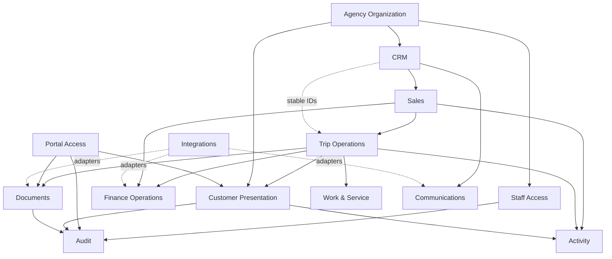

# TravelOS Domain Model

**Status:** Accepted — Phase 0 foundation  
**Model style:** Domain-driven modular monolith

## 1. Domain vision

TravelOS models the commercial and operational continuity of agency travel while ensuring that customer presentation is an explicit, immutable release. The Core Domain is the agency's ability to turn intent into a sold, operated and safely published trip with structured travel components and complete context.

## 2. Ubiquitous language

| Term | Precise meaning |
|---|---|
| Agency | Root tenant/business represented inside one deployment |
| Organization Unit | Branch, brand or business unit beneath the Agency |
| Team | Collaboration/assignment grouping; never a tenant or automatic data boundary |
| Person | Natural person in CRM |
| Customer | Commercial relationship/account with one or more Persons |
| Traveller | Trip-specific participation of a Person |
| Lead | Unqualified commercial interest/source record |
| Travel Request | Customer need, constraints and desired journey |
| Opportunity | Managed sales pursuit for a Travel Request |
| Quote | Container for commercial proposals over time |
| Quote Version | Immutable commercial proposal at a point in time |
| Proposal Alternative | Selectable option inside a Quote Version |
| Sale | Acceptance of one Quote Version/Alternative and its commercial basis |
| Trip | Operational journey after/planned around a Sale; source of mutable agency operations |
| Itinerary Item | Independent typed trip component such as one flight segment or one accommodation stay |
| Reservation | Supplier booking/commercial record that may cover several Itinerary Items |
| Workspace Revision | Monotonic Trip-level token changed by every publication-relevant mutation |
| Customer Projection | Narrow allowlisted presentation assembled from publishable source views |
| Preview | Pure read of the candidate customer projection at a workspace revision |
| Publication | Immutable versioned customer projection made active explicitly |
| Portal Principal | Customer-realm login that has only explicit Portal grants |
| Document Grant | Explicit permission for one Portal Principal to access a document/version in scope |
| Staff Invitation | Agency-scoped, single-use authorization to enrol a Staff Principal with one fixed lower-privilege role |
| Activity Entry | Human-readable operational history item |
| Audit Event | Append-only security/accountability evidence |
| Domain Event | Immutable domain fact meaningful inside a bounded context |
| Integration Event | Versioned message crossing a context/provider boundary |
| Outbox Message | Transactionally persisted message awaiting at-least-once dispatch |
| Provider | Capability adapter around an external technical system |

Forbidden ambiguous terms in code include `User` without realm, `CustomerUser`, `Booking` when Reservation or Itinerary Item is intended, `data`, `manager`, and `status` without its owning aggregate.

## 3. Subdomain classification

- **Core:** Sales continuity; Trip Operations; Customer Presentation/Publishing.
- **Supporting:** Agency Organization, CRM, Finance Operations, Documents, Work/Service, Communications, Activity.
- **Generic:** Authentication/session mechanics, storage drivers, notification delivery, job execution, observability.
- **Deferred:** Automation engine, AI assistance, fleet Control Plane, analytics warehouse.

## 4. Bounded contexts

| Context/module | Owns | Does not own |
|---|---|---|
| Agency Organization | Agency, OrganizationUnit, Team, branding draft, feature/plan references | Staff credentials; business records from other contexts |
| Staff Access | StaffPrincipal, StaffMembership, Role, PermissionAssignment, sessions/MFA | CRM Person or PortalPrincipal |
| CRM | Person, Customer, CustomerPerson relationship, TravellerGroup | Logins; Trip Traveller participation |
| Sales | Lead, TravelRequest, Opportunity, Quote, QuoteVersion, ProposalAlternative, Sale | Operational Trip mutations; payment ledger |
| Trip Operations | Trip, TripTraveller, ItineraryItem families, Reservation and links | Customer-facing snapshot; supplier SDK payloads |
| Customer Presentation | publication source contracts, preview, immutable retained Publication payload, current pointer, published agency profile | Mutable workspace, authentication, raw documents, storage implementation |
| Portal Access | PortalPrincipal, enrolment/session realm, TripAccessGrant | Staff roles; Customer ownership inference |
| Finance Operations | priced lines, costs, prices, fees, commissions, payment records/allocations | Full accounting ledger; provider SDK |
| Documents | Document, DocumentVersion, opaque provider object metadata, classification, DocumentGrant | Public static files; inferred trip grants; provider implementation |
| Work & Service | Task, CustomerServiceCase, assignment and service states | General communications transport |
| Communications | Conversation/message metadata and delivery requests | Vendor-specific email/SMS models |
| Activity | ActivityEntry projection and manual timeline notes | Security audit evidence |
| Audit | AuditEvent and access/export policy | Product timeline rendering |
| Integrations | provider ports/adapters, provider configuration references and webhook inbox | Core domain rules and protected payloads |
| Automation (deferred) | deterministic trigger-condition-action definitions | AI reasoning; direct database mutation |

### Context map

Solid arrows mean stable identifiers/contracts, not shared ORM objects. Dotted provider arrows are anti-corruption adapters. Cyclic source dependencies are forbidden.

## 5. Aggregate model and invariants

### Agency Organization

- **Agency** is the root business tenant and owns a stable `agency_id`.
- **OrganizationUnit** forms an adjacency tree under the Agency; V1 supports branches/brands without implying independent tenancy.
- **Team** groups staff for assignment only.
- At most one root Agency exists in a V1 deployment.
- A record may have an optional owning OrganizationUnit but always carries root `agency_id`.

### Staff Access

- **StaffPrincipal** is a credential/session identity.
- **StaffMembership** connects it to the single Agency and can be suspended independently.
- **Role** holds references to a code-owned Permission registry; assignments carry scope.
- Staff enrolment is invitation-only. A valid invitation is bound to the issuer-approved target email and the fixed `trip-operations-v1` template; acceptance creates the Staff identity, active membership, Agency-scoped role assignment, invitation consumption and audit event in one transaction.
- The invitation is single-use and expires after 60 minutes. The approved email binding is not an independent mailbox-verification claim. Enrolment issues no session; the invited Staff Principal receives no usable Admin context until TOTP MFA is enabled and verified.
- The last active Owner cannot remove/suspend themself or eliminate all Owners.

### CRM

- **Person** is a natural person and owns contact/identity details subject to privacy controls.
- **Customer** represents the commercial relationship, not a login. It can link several Persons with roles such as primary contact, traveller, payer or guardian.
- **TravellerGroup** is a convenience grouping. It conveys no access rights.
- Deduplication is an explicit merge use case with provenance; email equality never auto-merges Persons.

### Sales

- **Lead** is retained after qualification; qualification links to created/found Customer. M2 slice 1 (migration `0017`) implements it as a small aggregate: `source` (`WEBSITE`, `PHONE`, `EMAIL`, `REFERRAL`, `WALK_IN`, `OTHER`), a contact snapshot (given/family name, optional email and phone, all `CONFIDENTIAL_PERSONAL`), an `INTERNAL_ONLY` internal note, `state`, `qualifiedCustomerId`, `disqualificationReason`, `lock_version` and `closedAt`.
  - State changes are commands, never free-form status edits: `OPEN --update--> OPEN`, `OPEN --qualify--> QUALIFIED` and `OPEN --disqualify(reason)--> DISQUALIFIED`. `QUALIFIED` and `DISQUALIFIED` are terminal; every command on them fails with the typed `LEAD_NOT_OPEN` error, and a stale expected lock version fails with the existing typed optimistic conflict.
  - `QUALIFIED` holds exactly when `qualifiedCustomerId` is set, `DISQUALIFIED` exactly when a categorical reason (`NO_RESPONSE`, `NOT_INTERESTED`, `NOT_SERVICEABLE`, `DUPLICATE`, `OTHER`) is set, and `closedAt` is set exactly when the Lead is not `OPEN`.
  - Qualification has two explicit modes. `CREATE_CUSTOMER` creates, in one transaction, a Person copied from the contact snapshot, a Customer (display name `"<given> <family>"` unless provided) and a primary `PRIMARY_CONTACT` link. `LINK_CUSTOMER` links a caller-chosen Customer of the same Agency and creates or modifies no Person. Email equality never selects or links an existing Person or Customer; deduplication stays an explicit merge use case.
  - Qualify and disqualify append, in the same transaction as the state change, one Audit event, one Activity entry and one outbox message (`LeadQualified`/`LeadDisqualified`) that carries only identifiers and the new lock version. Lead data has no Portal contract, source field or database privilege.
- **TravelRequest** captures needs and constraints.
- **Opportunity** owns pipeline state and responsibility.
- **Quote** owns sequential immutable QuoteVersions.
- **QuoteVersion** includes one or more ProposalAlternatives and exact financial lines.
- **Sale** references exactly one accepted version/alternative. Later correction creates explicit amendment/credit semantics; it does not rewrite the accepted version.

### Trip Operations

- **Trip** owns lifecycle, title/dates, lead responsibility and `workspace_revision`, but does not contain every item as one giant transactional aggregate.
- **TripTraveller** is trip participation that references a Person and stores trip-specific role and safe snapshots needed for operations.
- **ItineraryItem** is an aggregate per structured component. Family subtype data is required and consistent with its discriminator.
- **Reservation** is a supplier booking aggregate, separate from items.
- **ReservationItemLink** is an explicit association. Cardinality is many-to-many: one PNR/package may cover many items; an item can exceptionally be fulfilled by multiple reservations. Business UI may guide toward a primary reservation without changing the model.
- Every link requires the same `agency_id` and `trip_id` on both ends.
- Publication-relevant changes to Trip, TripTraveller, publishable item fields, reservation presentation fields or published agency profile increment the affected Trip's workspace revision in the same transaction.

### Structured itinerary family model

Every item has a common envelope: identity, agency/trip, family, lifecycle state, ordering key, local/instant timing where relevant, location summary, traveller applicability and customer-presentation draft. Each family has typed details:

- **Flight:** one flight segment; carrier, flight number, departure/arrival airports, local datetimes, IANA zones, derived instants, terminals, cabin, baggage/seat presentation and operational status.
- **Accommodation:** property, check-in/out local dates/times/zones, room/board details and guest applicability.
- **Transfer:** origin/destination, pickup/drop-off timing, mode and meeting instructions.
- **Activity:** venue/location, scheduled window, participant applicability and instructions.
- **Insurance:** product/policy presentation, coverage dates and covered travellers; sensitive policy documents remain in Documents.
- **Vehicle Rental:** pickup/drop-off stations/times, vehicle class and driver applicability.
- **Rail/Ferry/Cruise:** operator, service/vessel/train, stations/ports, segment timing and accommodation/class fields.
- **Other:** mandatory title, service category, structured location and timing plus a versioned validated extension object. It is not an unrestricted dump for finance, credentials or internal notes.

A multi-leg air journey is several Flight items optionally grouped by a JourneyGroup and commonly linked to one Reservation/PNR.

Travel times store local civil time, IANA zone and derived UTC instant. An offset alone is insufficient. Published snapshots preserve the values used at publication.

### Customer Presentation

- **Publication** is append-only metadata plus an immutable schema-versioned payload while retained; a separate privileged privacy-deletion use case may remove the payload and preserve a typed deletion event/minimal lawful evidence.
- **CurrentPublicationPointer** is mutable and points to one active publication or none.
- **WithdrawalEvent** is append-only; withdrawal changes the pointer/state projection, never the old payload.
- A published document reference never grants access to the underlying Document.

### Finance Operations

- **Money** is a Value Object: signed integer minor units plus pinned ISO currency code/scale metadata. Every non-trivial calculation selects an explicit rounding policy; `HALF_UP` is only the ordinary V1 commercial default.
- **ExchangeRate** and **Percentage** are exact decimals, separate from Money.
- Cost, sale price, fee, discount, tax, commission, payment, refund and margin are different concepts.
- Payments are immutable facts with correcting entries/allocations; they are not arbitrary balance edits.
- Finance is operational subledger behaviour, not a claim of complete statutory accounting.

### Documents

- **StorageObject** owns immutable bytes by opaque storage key/checksum.
- **Document** owns business classification/association.
- **DocumentVersion** points to one StorageObject and has scan/quarantine state.
- **DocumentGrant** explicitly connects a PortalPrincipal to permitted document/version scope and expiry/revocation.
- A Document can relate to multiple domain records through typed associations, but each relation is Agency-scoped.

## 6. State machines

### Trip

`DRAFT → CONFIRMED → IN_OPERATION → COMPLETED`, with explicit `CANCELLED` transitions and controlled reopen rules. Publication is orthogonal; a DRAFT Trip may be previewed but only policy-authorized states may be published.

### Reservation

`PROVISIONAL → HELD → CONFIRMED → USED`, with `CANCELLED` and `FAILED`. Status change does not create/delete itinerary items.

### Publication

`CREATED` is immutable while retained. Current visibility derives from pointer plus append-only `PUBLISHED`, `SUPERSEDED`, `WITHDRAWN`, `PRIVACY_PAYLOAD_DELETED` events. A business correction is a new publication; privacy deletion removes the separate payload through a privileged audited command rather than editing its fields.

### DocumentVersion

`UPLOADING → QUARANTINED → SCANNING → AVAILABLE` or `REJECTED`; later `REVOKED/DELETED`. Only `AVAILABLE` versions may be granted/downloaded.

### Opportunity/Quote/Sale

Terminal transitions are commands, not free-form status edits. Quote Version is immutable once created. Sale acceptance is idempotent and requires a still-valid version.

## 7. Domain events

Representative past-tense events include:

- `LeadQualified`, `TravelRequestCreated`, `OpportunityStageChanged`;
- `QuoteVersionCreated`, `ProposalAccepted`, `SaleRecorded`;
- `TripCreated`, `TripTravellerAdded`, `ItineraryItemChanged`, `ReservationConfirmed`;
- `TripPublicationCreated`, `TripPublicationActivated`, `TripPublicationWithdrawn`;
- `PaymentReceived`, `DocumentVersionAvailable`, `DocumentGrantIssued`;
- `StaffRoleAssigned`, `PortalTripAccessGranted`.

Domain events are not automatically Audit Events or Activity Entries. Each consumer explicitly maps meaningful facts to its own model.

## 8. Consistency boundaries

| Rule | Consistency |
|---|---|
| Aggregate state transition and its domain event/outbox row | Same PostgreSQL transaction |
| Publish snapshot, sequential version and current pointer | Same serializable transaction with Trip lock/revision check |
| Reservation–Item same Trip/Agency | Database composite constraints plus application policy |
| Permission-changing action and success Audit Event | Same transaction where possible |
| Activity projection from domain event | Eventual, idempotent |
| External notification/provider call | After commit, at-least-once with idempotency |
| Document byte finalization and metadata | Bytes finalized first; metadata commit second; orphan cleanup is safe |
| Cross-context read | Stable ID/query contract; no cross-context aggregate mutation |

## 9. Domain walkthroughs that must pass

1. Two Flight items share one PNR Reservation.
2. A package Reservation covers Accommodation and Transfer.
3. An item with two supplier reservations remains one itinerary presentation item.
4. A payer who is not travelling has a Customer relationship but no TripTraveller.
5. A Traveller has no Portal login.
6. A Portal Principal can see a Trip but no traveller document.
7. A staff edit after preview makes the publish token stale.
8. An INTERNAL_ONLY supplier cost cannot be represented by the publication schema.
9. A cancelled reservation does not erase historical itinerary/publications.
10. A privacy deletion removes payload access from the active service while preserving minimal non-personal audit evidence; a retained encrypted backup copy remains governed by its approved expiry window.

## 10. Model quality self-assessment

**Candidate score: 9/10.** The model has explicit language, context ownership, small aggregates, contracts and invariants. The remaining point is deliberately reserved for independent adversarial review and real domain-expert feedback during the first vertical slices. Revisit context boundaries when changes routinely require synchronous writes across more than one aggregate or when domain experts reject the vocabulary—not merely because a module grows.
