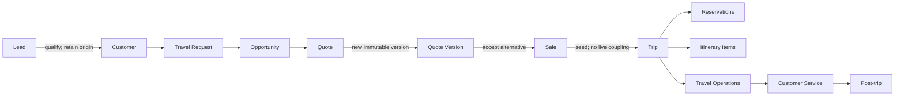

# TravelOS Product Blueprint

**Status:** Accepted — Phase 0 foundation  
**Owner:** Product Owner (Rui)  
**Technical steward:** Alex

## 1. Product vision

TravelOS is the operational source of truth for a travel agency. It preserves context from first contact through post-trip service and makes current responsibility, prior decisions, customer commitments and next actions understandable without searching unrelated tools.

The differentiating core is not a generic CRM or an AI assistant. It is the combination of a coherent travel-sales/operations lifecycle, structured itinerary data, controlled customer publication, and trustworthy history.

### North-star outcome

When an agency employee opens TravelOS, they can determine:

- what is happening;
- what needs attention;
- who is responsible;
- what happened previously;
- what must happen next.

A customer sees only information that the agency explicitly released to them, in a calm mobile-first Portal.

## 2. Product principles

1. **Architecture before feature breadth.** Build narrow vertical slices against a stable model.
2. **Works without AI.** Deterministic workflow and automation precede optional AI.
3. **History is a product capability.** Do not overwrite commercial commitments or published customer versions.
4. **Explicit publication.** Saving agency work never silently changes the Portal.
5. **Structured travel data.** Flight, accommodation and other itinerary families are typed business concepts, not prose blobs.
6. **Least privilege.** A relationship to a trip does not imply access to every traveller or document.
7. **One codebase.** Agency differences are configuration, branding, entitlements and providers—not forks.
8. **Dedicated by default, organization-aware inside.** Isolation at deployment/database level does not excuse missing organization scope in the model.
9. **Operational truth and customer presentation are different models.** Portal contracts are constructed allowlists.
10. **Automation and providers live at the edges.** Vendors do not dictate core language.
11. **Staff enrolment is invitation-only.** A lower-privilege Staff account is created through an audited, single-use invitation; public Staff signup and implicit Portal access are forbidden.

## 3. Actors and identities

| Term | Meaning | Not equivalent to |
|---|---|---|
| Agency | Root business customer of one TravelOS deployment | Branch, team or Portal customer |
| Organization Unit | Branch, brand or business unit within the root Agency | Independent tenant |
| Staff Principal | A login in the Agency security realm | Person, Customer, Traveller or Portal Principal |
| Person | A natural person known to the CRM | Login account |
| Customer | A commercial relationship/account with the Agency | Necessarily one Person or one Portal login |
| Traveller | A Person participating in one Trip, with trip-specific data | Customer, payer or Portal Principal |
| Traveller Group | A CRM grouping such as family/party | Authorization group |
| Portal Principal | A login in the customer Portal realm | Staff Principal or automatic owner of trip data |
| Supplier | Provider of a booked travel service | Integration provider implementation |
| Integration Provider | Adapter to an external technical service | Travel supplier record |
| Managed Operator | Authorized TravelOS operator performing fleet work | Hidden super-user inside an Agency instance |

The same human/email may correspond to a Person, Staff Principal and Portal Principal. Those records remain distinct and require explicit links; no privileges flow through email equality.

## 4. Lifecycle and record continuity

Arrows are business transitions or creation links, not instructions to mutate one record into another. Source identifiers remain available for traceability:

- qualification may create a Customer while retaining the Lead;
- a Travel Request can have multiple Opportunities only if explicitly supported later; V1 assumes one primary Opportunity;
- a Quote has immutable Quote Versions and proposal alternatives;
- a Sale references the accepted Quote Version/Alternative and freezes its commercial basis;
- a Trip may be seeded from a Sale but evolves independently for operations;
- Reservations and Itinerary Items are linked, not collapsed;
- customer publications are versions of presentation, not versions of the mutable Trip aggregate.

## 5. Product areas and phasing

### Core domain

- travel request, opportunity, quote/version/alternative and sale continuity;
- trip operations;
- structured itineraries and reservations;
- customer presentation and immutable publication.

### Supporting subdomains

- CRM, people, travellers and groups;
- finance operations;
- documents;
- tasks and customer-service cases;
- communications;
- activity history and reporting.

### Generic subdomains

- authentication and sessions;
- email/notification delivery;
- storage;
- observability and job execution.

### Explicitly outside the first implementation milestone

- full configurable sales pipelines;
- accounting-grade general ledger;
- supplier API integrations beyond fake/manual providers;
- payment collection;
- automation designer;
- AI;
- reporting warehouse/global search;
- Control Plane and fleet UI;
- shared-cloud multi-agency hosting;
- public/SEO itineraries;
- native mobile apps;
- real customer data.

## 6. Exact first Phase 1 milestone candidate

**M1 — Secure Published Trip Walking Skeleton**

A reproducible development build must prove, end to end:

1. bootstrap one Agency and one invited Staff Principal;
2. authenticate staff in the staff realm;
3. create a Customer linked to a Person and create a Trip Traveller from that Person;
4. create a Trip with one Flight segment and one Accommodation item;
5. create one Reservation linked to both items, proving the many-to-many association without merging concepts;
6. capture at least one `INTERNAL_ONLY` value (for example supplier cost/internal note) that has no Portal projection field;
7. generate a read-only customer preview without any publication row, version increment, pointer change, activity event or outbox message;
8. publish v1 with expected workspace revision and projection hash;
9. enrol a separate Portal Principal and grant that principal access to the Trip, but not to any document;
10. show v1 through the Portal using only the published read model;
11. edit the Accommodation and prove the Portal still shows v1;
12. reject a stale publish attempt with a typed `409` conflict;
13. publish v2, show v2, and retain v1 for staff audit;
14. pass role, cross-realm, IDOR, allowlist, migration, outbox-idempotency, mobile Portal and accessibility tests;
15. build a single immutable release artifact and run it in DEVELOPMENT only.

This milestone deliberately omits the complete Lead → Quote → Sale funnel. The next milestone extends backward through that lifecycle. M1 attacks the highest-risk architecture first rather than producing superficial breadth.

## 7. Non-functional envelope

These are V1 planning assumptions, not contractual SLAs.

| Area | V1 target/assumption | Revisit trigger |
|---|---|---|
| Availability | 99.5% monthly service objective per dedicated instance; no contractual HA claim | Paid SLA above 99.5%, multi-zone requirement or measured outage cost |
| Recovery | RPO ≤ 1 hour and RTO ≤ 4 hours | Contract requires tighter values or restore drills fail |
| Typical latency | API p95 < 500 ms for ordinary reads/writes at assumed load; publish p95 < 2 s excluding external notifications | SLO breach under representative load |
| Portal UX | Mobile-first; target LCP < 2.5 s on representative mobile network for cached static shell | Real-user data materially misses target |
| Accessibility | WCAG 2.2 AA for Admin and Portal critical paths | Legal/customer requirement is stricter |
| Scale per instance | ≤100 staff, ≤100 concurrent sessions, ≤10k active customers, ≤5k trips/year, ≤100k itinerary items/year | 70% sustained capacity or order-of-magnitude customer exception |
| Request load | 50 HTTP requests/s peak and 10 jobs/s peak are adequate initial planning envelopes | Load tests or telemetry exceed 70% |
| Documents | 250 GB per Agency planning ceiling; immutable object keys | Customer forecast or storage growth exceeds 70% |
| Data residency | One approved hosting jurisdiction per instance; backups remain in an approved jurisdiction | Customer/legal requirement differs |

Unknown future fleet size does not block Phase 1. The architecture assumes tens initially and must remain automatable toward thousands through immutable artifacts, manifests and uniform migrations.

## 8. Product invariants

Identifiers `INV-*` are authoritative and referenced by architecture/tests.

| ID | Invariant |
|---|---|
| INV-PUB-01 | Mutable workspace records are never a Portal read source. |
| INV-PUB-02 | Preview performs no database writes and cannot create/advance/activate a publication. |
| INV-PUB-03 | Publish requires the workspace revision and projection hash the staff user previewed; stale input fails closed. |
| INV-PUB-04 | A publication payload and metadata are immutable business facts; corrections create a new version. |
| INV-PUB-05 | Portal snapshot contracts are allowlists built field by field; denylist serialization and object spreading from persistence/domain records are forbidden. |
| INV-VIS-01 | `INTERNAL_ONLY` fields have no customer contract member and no configurable override. |
| INV-ID-01 | Staff and Portal principals use separate realms; an email match conveys no authority. |
| INV-DOC-01 | Trip/customer/group membership never grants document access; each Portal document access follows an explicit active grant. |
| INV-TEN-01 | Every Agency-owned reference remains in the same root Agency scope, even in a dedicated database. |
| INV-ITN-01 | Reservation and Itinerary Item are separate aggregates connected through an explicit many-to-many association. |
| INV-MNY-01 | Money is represented as integer minor units plus currency; binary floating point is forbidden. |
| INV-HIS-01 | Activity Timeline, Audit Log, application logs, domain events and outbox messages remain distinct. |
| INV-INT-01 | Domain/application modules import no vendor SDK. |
| INV-FLT-01 | All instances use the same versioned code and migration chain; customer code/schema forks are forbidden. |
| INV-DEL-01 | An approved privacy deletion removes protected payload access from the active service and retains only lawful evidence; retained encrypted backups may still contain an older copy until scheduled expiry, and the system never claims otherwise. |
| INV-HOST-01 | A request host selects only an exact manifest-declared surface, never an Agency; unknown/crafted hosts fail closed before branding/auth/data lookup. |
| INV-ID-02 | Staff enrolment is invitation-only; an invitation is single-use, bound to the issuer-approved target email, expires after 60 minutes, and atomically creates Staff access plus its audit evidence. Public Staff signup is forbidden. |
| INV-ID-03 | An invited Staff principal receives no usable Admin authorization context until TOTP MFA is enabled and verified; Staff and Portal identities remain separate. |

## 9. Retention assumptions

Retention is classification-driven and configurable within platform-enforced bounds. These defaults need legal/product confirmation before production, but do not block development with synthetic data:

- publication metadata and commercial versions: 7 years after trip completion;
- audit events concerning financial/security actions: 7 years;
- ordinary security/auth telemetry: 1 year;
- customer documents: trip completion + 1 year unless classification, contract, legal hold or consent requires otherwise;
- delivered outbox messages/job attempts: 90 days; unresolved dead letters retained until resolution plus 90 days;
- expired sessions and one-time tokens: delete promptly under the security schedule.

An approved privacy deletion removes/redacts the payload in the active system while preserving only lawful minimal evidence. It does not immediately rewrite retained immutable backups: encrypted backup copies may remain recoverable under restricted operational access until their approved retention expires. Restore therefore occurs in quarantine and reconciles known deletions before service opens. The maximum residual window and legal basis must be accepted per data class before production. “Immutable” never means ignoring a lawful deletion obligation, and “deleted” never means more than the controls actually prove.

## 10. Assumption and decision register

| ID | Assumption/decision | Rationale and consequence | Revisit trigger | PO acceptance |
|---|---|---|---|---|
| A-001 | One root Agency per deployment in V1 | Matches dedicated-instance constraint; branches remain internal units | Shared-cloud product decision | Accepted 2026-08-13 |
| A-002 | M1 starts at Trip rather than Lead | Proves highest-risk security/publication architecture first | PO requires funnel value before technical risk slice | Accepted 2026-08-13 |
| A-003 | No high-availability promise in V1 | One CT/database is a recoverable SPOF; honest SLO | Contractual SLA >99.5% | Accepted 2026-08-13 |
| A-004 | RPO ≤1h/RTO ≤4h are engineering targets, not guarantees | Sensible managed-instance baseline; must be measured by rehearsal | Customer contract or restore evidence | Accepted 2026-08-13 |
| A-005 | Portal historical publications are staff-auditable but customers see current active version only | Simpler customer semantics and avoids confusion | Customer/legal need for version history | Accepted 2026-08-13 |
| A-006 | Staff MFA is mandatory in production | Sensitive traveller, finance and document data | None; relaxing requires security ADR | Accepted 2026-08-13 |
| A-007 | Portal MFA is optional in V1 | Lower customer friction; explicit grants constrain data | High-risk products/customer demand | Accepted 2026-08-13 |
| A-008 | HALF_UP is the commercial V1 default only; tax, FX, payment, supplier and accounting contexts select explicit policies | Predictable ordinary pricing without misrepresenting specialist rules | New jurisdiction/provider/accounting requirement | Accepted 2026-08-13 |
| A-009 | `PrivateFilesystemProvider` is acceptable first, behind the storage port with no domain filesystem dependency | Avoids MinIO/S3 per CT while keeping provider portability; production requires private authorized storage plus tested encrypted backup/restore | Scale, HA or storage contract | Accepted 2026-08-13 |
| A-010 | GitHub Actions is the initial CI target once a repository host exists | Practical default; pipeline contract stays vendor-neutral | Different repository host | Accepted 2026-08-13 |
| A-011 | V1 uses active deletion/redaction, encrypted access-separated backups and bounded retention; granular crypto-erasure is deferred pending legal/threat justification | Avoids an unproven critical key/ledger dependency while stating the residual backup window honestly | Legal advice, customer contract or threat model rejects residual window | Accepted 2026-08-13 |

## 11. Product-owner acceptance gate

Rui accepted the V1 package with the adjustments recorded by the Product Owner (review records removed in ADR-016). This acceptance does not waive independent technical closure. Items requiring pre-production evidence remain engineering targets, not customer commitments. Any change to a critical invariant requires an ADR and updates to all dependent documents.
