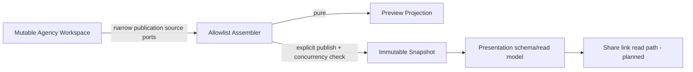

# TravelOS Publishing Model

**Status:** Accepted — Phase 0 foundation  
**Governing ADRs:** ADR-004, ADR-014

## 1. Safety property

Anything customer-facing (a later read-only share link, ADR-016) must never read, query, serialize or infer customer trip presentation from mutable agency workspace tables. It reads only the frozen snapshot created by an explicit release operation.

This is a stronger guarantee than hiding fields in UI code.



There is no arrow from Workspace to the share link read path.

## 2. Structural separation

### Separate contracts

`TripSnapshotV1` is authored from zero as a narrow schema. It must never be derived with `Omit`, a denylist, generic serialization, object spreading or an ORM/domain type.

Workspace modules expose family-specific `PublicationSource` query ports containing only fields eligible for publication. Internal finance, supplier operations, staff notes, credentials, raw provider payloads and audit data are absent at the type and SQL-selection level.

### Separate persistence privileges

The customer-facing read path (to be designed with share links) may read only the published `presentation` data, never mutable CRM, Sales, Trip Operations, Finance or internal Document metadata tables. Admin runtime and migration roles are separate.

### Separate route/module graph

Customer-facing handlers depend only on Customer Presentation read contracts. Architecture tests reject imports from workspace repositories or Admin controllers.

## 3. Field visibility

Every potentially customer-facing field has a stable platform field key and one platform classification:

- `INTERNAL_ONLY` — impossible to expose; absent from source/target customer contracts and no override row is valid.
- `ALWAYS_CUSTOMER` — included when a value exists; an Agency cannot hide a legally/product-required field.
- `CONFIGURABLE` — resolves Platform Default → Agency Default → Item Override.

Agency/item choices are `INHERIT`, `SHOW` or `HIDE`; an override cannot convert an `INTERNAL_ONLY` field. Unknown field keys fail publication validation instead of defaulting visible.

Effective decisions are recorded as non-sensitive publication diagnostics, but hidden/internal values are never copied into snapshot metadata.

## 4. Workspace revision contract

Each Trip owns a monotonic 64-bit `workspace_revision`.

Every transaction that changes publication-relevant Trip, Traveller, Itinerary Item, Reservation presentation or agency profile data must:

1. lock or compare the Trip revision;
2. perform the mutation;
3. increment `workspace_revision` exactly once for that transaction;
4. commit the domain event/outbox record atomically.

Internal-only changes that cannot affect presentation need not increment it. The publishable-field registry owns that distinction; individual controllers may not improvise it.

All mutable aggregates also use their own optimistic `lock_version` for ordinary edits.

## 5. Preview semantics

Preview is a pure query use case:

1. authorize `trip.preview`;
2. read a consistent snapshot of all publication sources at one workspace revision;
3. resolve field visibility;
4. construct and validate the current snapshot schema;
5. canonicalize it and calculate SHA-256 projection hash;
6. return `{workspaceRevision, projectionHash, schemaVersion, projection}`.

Preview performs **zero database writes**. It does not:

- insert a publication/version/token;
- update the current pointer;
- increment workspace revision;
- create Activity/Audit/Outbox/Job records;
- reserve a version number;
- notify customers.

Infrastructure access logs may record that an HTTP read occurred, without projection content or PII. Closing/reopening preview has no state effect.

## 6. Publish command and concurrency

The command is conceptually:

```text
PublishTrip(tripId, expectedWorkspaceRevision, expectedProjectionHash, idempotencyKey)
```

Inside one PostgreSQL `SERIALIZABLE` transaction:

1. authorize `trip.publish` and current step-up assurance;
2. acquire a row lock on the Trip publication coordinator/current pointer;
3. verify current workspace revision equals `expectedWorkspaceRevision`;
4. rebuild the allowlist projection using the same pure assembler used by preview;
5. verify canonical hash equals `expectedProjectionHash`;
6. validate the versioned snapshot schema and policy invariants;
7. allocate `version = previous maximum + 1` under the same lock/unique constraint;
8. insert immutable Publication metadata and the one-to-one validated canonical payload;
9. atomically point `CurrentPublicationPointer` to it;
10. insert success Audit Event, domain events and outbox messages;
11. commit.

A revision/hash mismatch returns typed `409 STALE_PUBLICATION_CANDIDATE` with no publication side effect. Serializable conflicts are retried only within a small bounded budget; a semantic stale conflict is never auto-rebased.

The idempotency key is unique for Agency/principal/command scope. A duplicate completed command returns the same publication; it cannot create v+1.

## 7. Immutable snapshot record

Publication metadata includes:

- opaque publication ID, Agency ID and Trip ID;
- monotonically increasing Trip publication version;
- source workspace revision;
- snapshot schema name/version;
- canonical projection SHA-256 hash;
- publisher Staff Principal and assurance context;
- publication timestamp;
- idempotency key and correlation ID;
- immutable validated canonical payload while retained, stored separately from immutable publication metadata.

Before insertion, the canonical snapshot is validated and hashed. Database storage and off-instance backups are encrypted at rest under access-separated operational key management. Database permissions deny routine runtime `UPDATE`/`DELETE` on publication metadata and payload. Business correction creates a new publication. The current pointer is the only mutable selection mechanism.

The customer-facing read path joins only the active pointer to a still-present payload. After link authorization, a narrow presentation adapter verifies the canonical hash and parses the declared schema before returning a customer DTO. It never persists the payload as a static asset or generic cache.

A publication contains no credentials, supplier cost, margin, internal notes, raw provider payload, private document URL or staff-only identifier.

## 8. Snapshot schema evolution

- Every payload declares an integer schema version.
- New publications use the current schema only.
- A registry has a parser and renderer/upcaster chain for every retained historical schema version.
- Upcasting creates an in-memory current presentation; it never overwrites the retained historical payload.
- Every schema version has immutable golden fixtures and contract tests, including adversarial unexpected fields.
- A breaking change adds a new version and explicit adapter; it never changes the meaning of an existing version.
- Removal of a renderer is allowed only after retention/deletion policy proves no payload of that version remains.
- Derived caches may be rebuilt and deleted; they are not the historical source.

A release is migration-incompatible if it cannot render every retained snapshot version in that instance. Upgrade preflight must test this.

## 9. Activation, supersession and correction

- Publishing v2 atomically moves the pointer from v1 to v2. v1 metadata/payload remains intact for authorized staff history.
- Customers see only the current active version by default. Historical customer access is a future explicit feature, not an enumerable endpoint.
- Correction means edit workspace, preview, publish a new version.
- Rollback to an old payload requires a new publication created from an explicitly approved projection. The pointer is not casually pointed backward because that would hide a new release event.
- Notifications are asynchronous consequences after commit and cannot determine publication success.

## 10. Privacy deletion, retention and legal holds

Business immutability does not override privacy law.

A highly privileged, dual-confirmed and idempotent privacy workflow may:

1. verify authorization/legal basis and holds;
2. clear the current pointer if it selects the affected publication;
3. delete only the separate `publication_payload` row through the narrowly privileged command;
4. append `PRIVACY_PAYLOAD_DELETED` and safe Audit evidence in the same transaction;
5. retain only lawful metadata—publication ID/version, timestamps and non-reversible content hash;
6. make historical rendering return a typed deleted-payload state.

This exceptional process is not a normal edit and cannot be used to rewrite commercial history. It removes the payload from the active service, logs and derived caches, but does **not** claim immediate unrecoverability from every pre-deletion encrypted backup. Such copies remain under restricted access until their approved retention expires. Restore is network-closed and must reconcile all available post-backup deletion records before service opens. Before production, legal/privacy and threat-model review must accept the residual window per data class or trigger a superseding ADR for crypto-erasure or an equivalent control under ADR-014.

## 11. Customer-facing data classes

The rule applies to every customer-facing surface:

- **Trip overview/itinerary:** current Trip Publication snapshot.
- **Agency profile/branding/contact:** separately published Agency Profile snapshot or immutable deployment presentation configuration.
- **Documents:** explicit release/grant plus authorization at each download; never embedded secret URLs.
- **Payments:** future explicit Customer Financial Statement publication/read model; internal Finance tables are not queried live.

Adding a customer-facing section requires naming its source/read model and release semantics in an ADR.

## 12. Required verification scenarios

1. Preview leaves publication tables, pointer, Activity, Audit, Outbox and jobs byte-for-byte/logically unchanged.
2. Saving hotel after preview makes revision/hash stale and publish fails with no version allocated.
3. Two concurrent publishes cannot both allocate the same/new different versions from one preview.
4. Duplicate idempotency key returns the original publication.
5. v1 remains visible after workspace changes and before v2.
6. INTERNAL_ONLY fixture values cannot be represented by or found in serialized snapshot output.
7. Unknown fields cause schema validation failure, not permissive passthrough.
8. The customer-facing read path is denied direct workspace `SELECT`.
9. Every retained schema fixture renders after an application upgrade.
10. Share-link revocation (planned) removes customer availability without mutating historical payload.
11. A deleted payload is absent from customer-facing paths, staff UI, search, export, logs and derived caches in the active service.
12. Restore remains network-closed until available deletion records are reconciled; the drill records the oldest residual backup copy and its scheduled expiry without claiming earlier unrecoverability.

Any failure in scenarios 1–9 is a release BLOCKER. Scenario 10 becomes a release BLOCKER when share links enter scope; scenarios 11–12 and legal/threat acceptance of the residual backup window are production BLOCKERs before real protected customer data is accepted.
