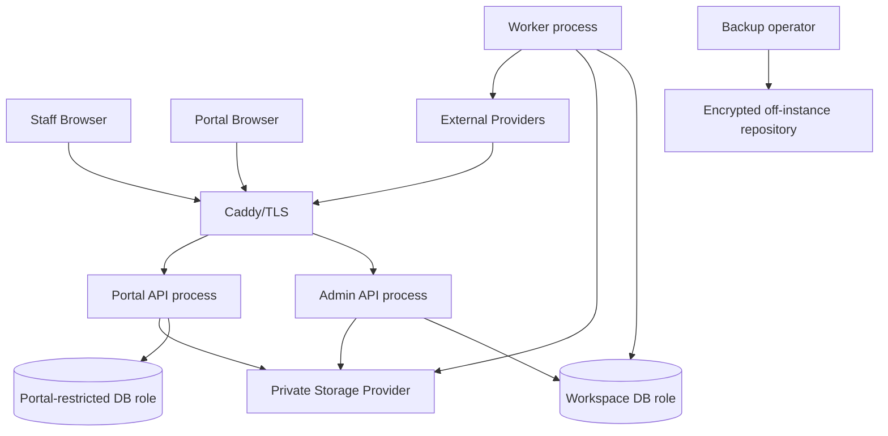

# TravelOS Security and Document Model

**Status:** Accepted — Phase 0 foundation  
**Governing ADRs:** ADR-007, ADR-008, ADR-011, ADR-014

## 1. Objectives

TravelOS protects sensitive traveller, commercial, identity, financial and document data under a dedicated-instance model. Dedicated infrastructure reduces tenant blast radius but does not replace authorization, data classification or secure coding.

Security properties:

- default deny and least privilege;
- separate Staff and Portal security realms;
- structurally restricted Portal data path;
- explicit Portal Trip and Document grants;
- no secrets/customer payloads in logs, snapshots, URLs or static bundles;
- auditable privileged actions and revocation;
- reproducible patched deployments and restorable encrypted backups.

## 2. Trust boundaries

Admin API, Portal API and Worker are separate OS processes/composition roots from one release. They do not call each other synchronously. The Portal process lacks workspace database credentials.

## 3. Data classification

| Class | Examples | Baseline controls |
|---|---|---|
| Public | deliberately published generic agency contact/branding | Integrity, versioning, safe caching |
| Customer-visible | active publication fields, explicitly released instructions | Portal grant, allowlist snapshot, TLS, no public enumeration |
| Confidential | CRM contacts, reservations, communications, ordinary internal documents | Staff RBAC/scope, encryption/backup, audit on sensitive actions |
| Restricted | passports/IDs, visas, medical/accessibility data, payment details, supplier costs/margins, auth secrets | Minimal collection, field/document permissions, step-up auth, no logs, short retention/export controls |
| Security | password hashes, MFA seeds, recovery/session/reset tokens, provider credentials | Dedicated stores/secret references, encryption, hashing where appropriate, never export through product |

Every new field declares classification, owner, Portal eligibility, retention and audit requirements before migration approval.

## 4. Threat model

| Threat | Primary controls | Required verification |
|---|---|---|
| Portal reads mutable/internal Trip data | Separate Portal process/DB role; presentation schema only; allowlist contracts | DB privilege denial and import-boundary tests |
| INTERNAL_ONLY serialization | No Portal contract member; narrow SQL source; schema rejects unknowns | Adversarial sentinel/golden tests |
| Stale/concurrent publication | revision + hash + row lock + serializable transaction + idempotency | concurrent publish tests |
| Cross-realm session confusion | separate hosts/paths/cookies/secrets/tables/auth instances | wrong-cookie and fixation tests |
| Host-header/custom-domain confusion | exact manifest FQDN allowlist at Caddy and API; proxy overwrites forwarded host; no host-to-tenant lookup | unknown/crafted Host and X-Forwarded-Host probes with uniform rejection |
| IDOR/cross-Agency lookup | Agency-scoped repositories/composite FKs; generic errors | IDs, metadata, counts, timing, downloads |
| Same-trip document leakage | independent DocumentGrant evaluated per request; protected downloads always traverse Portal API | grant/no-grant/revocation and previously issued URL tests |
| Credential theft | TLS, HttpOnly host-only cookies, MFA, CSP, secret storage, rate limiting | cookie/header/no-JS auth tests |
| CSRF | SameSite cookies, Origin/Host checks, framework CSRF tokens where required | cross-origin state-change denial |
| Stored/reflected XSS | React escaping, sanitize rich text, restrictive CSP, no arbitrary HTML | payload suite and CSP tests |
| Malicious upload | limits, streaming, type detection, quarantine, malware provider, immutable object key | EICAR/polyglot/archive-bomb tests |
| Path traversal/symlink attacks | opaque keys, provider root confinement, no user paths, no symlink follow | traversal/race tests |
| Provider/webhook forgery/replay | signature/timestamp, raw-body verification, inbox uniqueness, idempotency | replay/old timestamp/bad signature tests |
| SQL injection | parameterized Kysely queries; reviewed raw SQL | static review and injection tests |
| Secret/PII log leak | structured allowlist logging and centralized redaction | canary-secret test; log scan |
| Dependency/supply-chain compromise | lockfile, provenance/SBOM, scanning, pinned runtime, review | CI policy and update drills |
| Database/migration privilege abuse | separate owner/runtime/Portal roles, checked migrations, backup | privilege and restore tests |
| Audit tampering | insert-only runtime, trigger/privilege protection, off-instance signed checkpoints | mutation denial/checkpoint verification |
| Backup theft/loss | encrypted off-instance copies, separate credentials, restore drills | scheduled restore and access review |
| Deleted PII remains in an older backup | honest residual-window policy, encrypted/access-separated backups, bounded verified expiry, isolated restore and deletion reconciliation; stronger crypto-erasure only if justified | legal/threat acceptance plus oldest-retained-backup restore/expiry drill |
| Support abuse | no universal account; expiring customer-approved local access | access expiry and customer-visible audit |
| Resource exhaustion | quotas, bounded uploads/queries, rate limits, job leases/timeouts | load/abuse tests |

## 5. Authentication

Architecture is defined in `PERMISSIONS.md`. Two independent Better Auth instances are integrated only at NestJS delivery adapters; Better Auth publishes a NestJS integration path.[6]

Mandatory controls before production:

- production Staff MFA and recent-MFA step-up for high-risk actions;
- passwords accepted only in POST bodies over TLS; no GET fallback under failed JavaScript;
- generic enrolment/reset responses; per-IP and per-identity throttles with bounded lockouts;
- password reset/session refresh rotate tokens and prevent replay;
- session IDs and reset/invitation/recovery tokens are hashed or stored according to library threat guidance; raw one-time tokens never logged;
- credential/MFA changes revoke other sessions and create Audit Events;
- staff/Portal cookies use unique names, `Secure`, `HttpOnly`, appropriate `SameSite`, no parent-domain scope;
- custom Portal domains receive isolated host cookies; Admin cookies never span them;
- canonical request host must match the manifest surface allowlist before any auth handler runs; APIs trust forwarded host information only from Caddy and Caddy overwrites client-supplied forwarded headers;
- authentication assurance and authorization epoch are checked server-side, not trusted from browser claims.

Dependency qualification includes security advisory review, table/schema isolation, upgrade/migration policy, cryptographic defaults and independent auth abuse tests. TravelOS never implements password hashing, MFA algorithms or session token generation itself.

## 6. Authorization and isolation

Authorization follows `PERMISSIONS.md` and occurs inside every use case/repository query. The database roles are:

- migration owner: DDL only during controlled deployment, no routine application login;
- Admin runtime: scoped DML on workspace, presentation commands, outbox and audit insert;
- Portal runtime: Portal realm/grant data plus active presentation views; no workspace privileges;
- Worker runtime: only tables/functions required by registered handlers;
- backup/monitoring roles: narrowly scoped, separate credentials.

Credentials are unique per instance and role. A process never receives a more privileged credential “for convenience.” Connection strings are secret references and are absent from instance manifests.

A dedicated database is still tested with multiple Agency fixtures at repository level to ensure scope cannot disappear if deployment assumptions evolve.

## 7. Document security model

### Storage

Bytes are behind a `StorageProvider`. The first adapter may be `PrivateFilesystemProvider` inside the instance backup boundary. Domain/application code receives only opaque object IDs and capability methods; it must not import paths, filesystem APIs or provider SDK types. S3/MinIO or another adapter can replace it without changing Document, grants or publication contracts.

- opaque, random, immutable object keys; no customer filename/path in storage key;
- root directory inaccessible to Caddy/static hosting;
- dedicated OS identity and root confinement; symlinks and path traversal refused;
- create via exclusive temporary object, stream with size limit and checksum, fsync/finalize atomically, then commit metadata;
- content type is detected from bytes and allowlisted; client MIME/extension are untrusted;
- original filename is sanitized display metadata only;
- encryption at rest is mandatory for private storage/dataset and backups; keys/secrets are access-separated from backup data;
- orphan objects are safe and reconciled; a database row must never point to an object not durably finalized.

### Upload pipeline

1. authorize and enforce classification-specific size/type/quota;
2. stream to an isolated temporary/quarantine area—never application memory/public path;
3. calculate SHA-256 and inspect actual type/archive limits;
4. create QUARANTINED metadata;
5. run `MalwareScanProvider` asynchronously with pinned engine/signature metadata;
6. mark AVAILABLE only on a clean result; fail closed on scanner error/timeout;
7. reject/erase malicious bytes according to incident policy and audit the action.

A production instance cannot enable customer document downloads without a configured scanning policy. Development uses a deterministic fake scanner and EICAR tests; it is visibly non-production.

### Grants and downloads

- Staff download requires explicit permission/resource scope.
- Portal listing and download each require active TripAccessGrant where applicable **and** active DocumentGrant for the principal/document/version.
- Granting “latest version” is explicit; otherwise a grant pins a version.
- A document reference in a publication is display metadata, not authority.
- Portal API streams/proxies every Confidential or Restricted file only after a fresh authorization check. V1 issues no direct storage URL or bearer download capability for protected Portal documents.
- Response uses safe `Content-Disposition`, `X-Content-Type-Options: nosniff`, restrictive CSP/sandbox for inline-safe types, and attachment download for risky types.
- Revocation takes effect before the next response begins because every request rechecks TripAccessGrant, DocumentGrant, session and authorization epoch. Bytes already delivered or already in flight cannot be clawed back; the service aborts a stream when practical after session/connection termination but never claims retroactive revocation.
- A future CDN/direct-download capability is allowed only for explicitly Public, non-personal assets, or through a gateway that rechecks the current revocation epoch on every request. Enabling protected-document signed URLs requires a superseding security ADR and a revocation drill.
- Upload, scan, view-sensitive-metadata, download, grant, revoke, reject, erase and export are Audit Events. Document content is never logged.
- Active document deletion first revokes grants/marks `DELETING`, then calls the provider idempotently by opaque object ID, confirms absence and records `DELETED`; reads fail closed throughout and a crash resumes rather than reauthorizing the object.

## 8. Web and API security

- TLS is mandatory outside local development; HSTS after domain/TLS validation.
- Admin and Portal use separate hostnames where possible; same-origin `/api` proxy avoids broad CORS.
- Caddy and each API independently require an exact normalized host from the instance manifest. Unknown/malformed hosts, duplicate/conflicting host headers and client-supplied forwarded hosts are rejected before branding, auth or data lookup with one fixed unbranded response; no wildcard/suffix tenancy lookup is permitted.
- CSP defaults to `default-src 'self'`, no inline script/eval, narrowly approved image/connect sources; frame ancestors deny unless an ADR allows embedding.
- Other headers: `nosniff`, strict Referrer-Policy, Permissions-Policy, frame protection and safe cache directives.
- API request/response schemas reject unknown fields at trust boundaries.
- REST errors use stable codes and correlation IDs without stack traces, SQL details or record existence leakage.
- State-changing commands support idempotency where retries are plausible.
- All list/search endpoints are bounded/cursor-paginated; uploads and decompression have hard limits.
- Rich text, if introduced, uses an allowlist sanitizer at write and render boundaries; Markdown/HTML is never trusted.
- Static Vite bundles contain no environment secrets, credentials or customer-specific data. After host validation, runtime branding/configuration is fetched from the instance's published Agency profile; Host is not a tenant lookup key.

## 9. Secrets and provider credentials

- Secrets live in an encrypted secret manager/systemd credential store and enter only the target process.
- Configuration stores secret reference IDs, never secret values.
- No secret in Git, `.env` committed files, database customer settings, publication, audit, Activity, job payload, provider error, screenshot or support bundle.
- Credentials are unique by environment/instance/provider, least-privileged, rotatable and inventory-backed.
- Secret access/rotation is audited operationally without recording the value.
- Provider adapters redact request/response payloads and map errors to safe categories.

## 10. Webhooks and external integrations

Inbound webhook handling:

1. enforce body/size/rate limit and retain raw bytes only as needed for signature verification;
2. resolve provider configuration without user-controlled adapter selection;
3. verify signature, timestamp/nonce and expected destination before parsing business data;
4. insert an inbox row with unique provider/external event ID and payload hash;
5. acknowledge duplicates idempotently;
6. process asynchronously through anti-corruption mapping and normal commands/authorization policy;
7. quarantine malformed/unmapped events; never mutate core tables directly.

Outbound calls have connect/read deadlines, bounded retry with jitter and circuit-breaker/bulkhead policy. Every effectful operation persists one stable TravelOS operation ID/business key and request hash before the first call. An adapter must provide either provider-enforced idempotency under that stable key or a read-after-write reconciliation lookup that can prove the outcome after timeout/crash. `UNKNOWN_OUTCOME` always reconciles before any retry. A provider that supports neither remains manual/disabled for that effect; TravelOS never blindly retries a potentially successful booking, payment, document release or notification. Credentials and supplier booking references are never used as log correlation IDs.

## 11. Audit, logging and incident evidence

AuditEvent contains Agency, timestamp, principal type/ID, authentication assurance, action, target safe identifiers, scope, outcome, reason code, request/correlation IDs and safe changed-field names. It does not store full before/after records, passwords/tokens, document data or raw provider payloads.

Denied sensitive actions are audited without leaking target data. Read auditing is classification-based: restricted document/download, export and audit access are always recorded; ordinary list reads may use security telemetry to avoid unusable Audit volume.

Application logs and traces use pseudonymous IDs and redaction. Support bundles are allowlist exports. Security events have alert thresholds and incident runbooks before production.

## 12. Privacy, retention and deletion

- collect only operationally required special-category/identity data;
- record purpose/legal basis/consent where required before production;
- support subject export through a privileged audited job;
- classification drives retention and deletion;
- legal hold blocks deletion with explicit evidence;
- publication/document deletion removes the active payload and retains only lawful minimal evidence through a privileged audited workflow;
- database, private storage and off-instance backups are encrypted at rest with access-separated recovery material and bounded, monitored expiry;
- a retained backup created before deletion may remain recoverable until expiry; TravelOS does not label that copy erased or hide the residual window;
- restore is isolated/network-closed, proves coverage of the recovery interval from approved deletion-request/Audit/operational evidence, reconciles identified deletions and fails closed for affected payloads when coverage is incomplete; absence in the restored database is never treated as proof and privacy approval cannot waive potential active resurrection;
- non-production uses synthetic or approved sanitized data only.

Legal/privacy review of EU/Portugal travel-agency obligations and a concrete threat-model review are required before production, not before synthetic-data Phase 1. They must accept maximum backup retention/residual deletion windows per data class or require a superseding ADR for crypto-erasure/provider-native deletion or an equivalent control.

## 13. Security release gates

No production release until:

- threat model and data classification are updated for implemented scope;
- Staff MFA, realm/session isolation, CSRF/CSP and no-JS credential safety pass;
- Portal DB role cannot query workspace tables;
- authorization matrix and direct API abuse tests pass;
- INTERNAL_ONLY sentinel scan passes every Portal response/snapshot/log;
- document scanning/grants/download controls pass if documents are enabled;
- crafted/unknown Host and X-Forwarded-Host probes are rejected uniformly at edge and API;
- dependency/secret/static/container scans pass;
- encryption-at-rest/key-management controls, verified backup expiry and isolated oldest-retained-point restore are demonstrated;
- active deletion plus restore reconciliation pass, and legal/privacy + threat-model owners accept the residual backup window or require a stronger superseding control;
- no open BLOCKER/HIGH security finding remains.

## Sources

[6] https://www.better-auth.com/docs/integrations/nestjs
